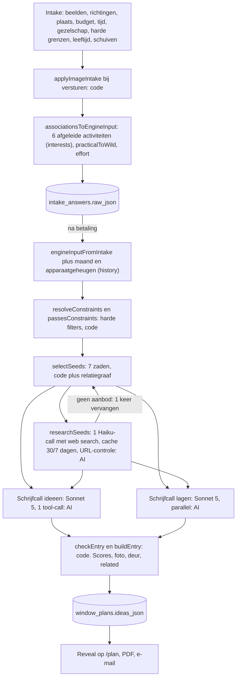
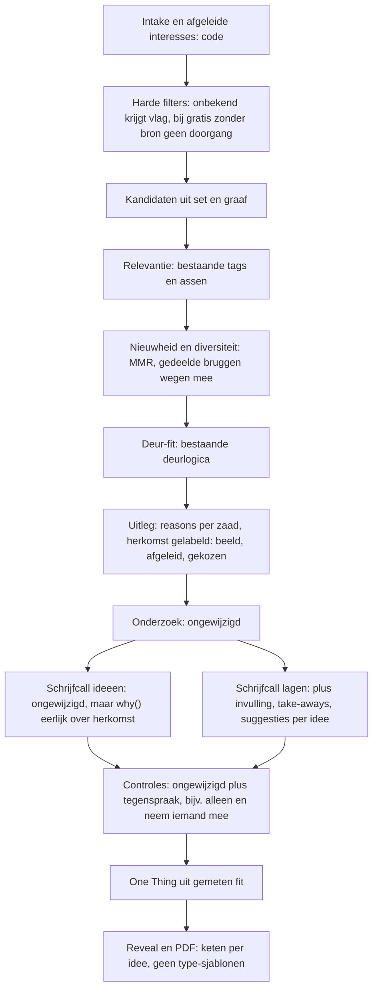

# Kennisengine — auditrapport (Stage A)

Opgesteld op 27 oktober 2026, op branch `main` (commit `ad6ba3c`), met `WINDOW_Bouwopdracht_Kennisengine.md` als opdracht. **Stage A heeft geen applicatiecode veranderd.** Enige wijzigingen buiten de documenten: de regel `/data/sources/raw/` in `.gitignore` en de nieuwe map `data/sources/raw/` (niet gecommit). Bronnenregister: [`knowledge-sources.md`](knowledge-sources.md). API-kosten van Stage A: **€0** (geen enkele betaalde aanroep).

## 0. Conclusie in tien regels

1. **Dekking is niet het grootste knelpunt.** Over 500 profielen komen 375–398 van de 423 activiteiten ooit voor; de populairste activiteit staat in ~11% van de boeken. Wel zijn er drie echt dunne plekken: digitaal/gaming (±20 activiteiten), persoonlijke uitdagingen (6) en "thuis" (er is geen facet voor).
2. **Het grootste knelpunt zit in wat er ná de selectie met een idee gebeurt.** De PDF-blokken "Een mogelijke invulling", "Wat je eraan overhoudt" en "Maak het van jou" komen uit **10 vaste sjablonen** voor alle 423 activiteiten. Dat geeft aantoonbaar tegenstrijdige tekst: "Neem iemand mee die je leuk vindt" bij *Gezelschap: alleen ik*, "Loop of kijk waar je zin in hebt" bij imkeren, "Neem contant geld of een pinpas mee" bij een online cursus cryptografie.
3. **Een afgeleide interesse wordt aan de schrijver verkocht als "iets wat de persoon koos".** In de beeld-intake kiest de bezoeker beelden, geen activiteiten, maar de motor behandelt de 6 uit de beelden afgeleide activiteiten als "picks". Gevolg in echte boeken: "*Je interesse in vogels kijken bracht je hier*" terwijl vogels kijken nooit gekozen is.
4. **"Als je er maar één kiest" is geen maat voor passendheid.** Het wordt bepaald door vaste cijfers per richting. Gemeten: in **72%** (kaartenwizard) en **88%** (beeld-intake) van de boeken is het de *onverwachte* deur, terwijl de tekst belooft "dit past het best bij je situatie".
5. **Onbekend scoort soms gunstig.** 4 activiteiten hebben onbekende kosten en passen door het filter "gratis"; in 25% (kaarten) en 37% (beelden) van de boeken met budget *gratis* zit er zo'n activiteit in.
6. **Harde regels zijn in orde**: 0 overtredingen in 3 × 500 profielen (E1, E3, E4, E5, E6). Dat moet behouden blijven.
7. **Jans hypothese** (meer body, zichtbare gedachtegang, concretere invulling wijst op generatie, niet op dekking) wordt **grotendeels bevestigd**, met twee voorbehouden (§4): de feedback van 19 oktober en de oude boeken zijn niet meer te raadplegen, en twee van de drie punten zijn sindsdien deels gebouwd (R2.2 draad, R2.3 lagen).
8. **Bronnen:** één bruikbaar (S3 Wikidata, CC0, ± 20 nieuwe kandidaten en 133 NL-labels), één alleen als naamlijst (S2, AI-gegenereerd), drie afwijzen (S1 NC-ND, S4 fitness/merknamen, S5 synthetisch). Een grote import levert dus geen "sprong in kwaliteit".
9. **Voorstel (A5):** eerst het evaluatieharnas, daarna activiteit-specifieke invulling en een eerlijke gedachtegang, dan stapsgewijze ranking, en pas daarna gerichte dekking. Geen embeddings, geen nieuwe database.
10. **Stop.** Geen code vóór akkoord van Jan op de besluiten in §6.

---

## 1. A1 — Code-audit

### 1.1 Architectuur en datastroom

Gelezen: `intake/actions.ts`, `discovery/imageIntake.ts`, `discovery/associations.ts`, `engine/*`, `claude/generateFromSeeds.ts`, `claude/localResearch.ts`, `plan/data.ts`, `pdf/ideaContent.ts`, `possibilityMap.ts`. De route voor de standaardvariant (beeld-intake) is:

| Stap | Deterministisch of AI | Data | Model en prompt |
|---|---|---|---|
| `applyImageIntake` / `associationsToEngineInput` (`associations.ts:246`) | Code | 189 beeldkaarten met `tagWeights` en 3 assen, 423 activiteiten | geen |
| `resolveConstraints`, `passesConstraints` (`engine/constraints.ts`) | Code | budget, inspanning, wildheid, sociale vorm, seizoen, vrije tekst (alleen binnen/buiten, "geen groepen", "gratis") | geen |
| `selectSeeds` (`engine/select.ts:77`) | Code (seed uit sessie-id, dus herhaalbaar) | bibliotheek, 42 tags, 50 hybrids, relatiegraaf (`graph.ts`) | geen |
| `researchSeeds` (`claude/localResearch.ts`) | AI | live web search; cache `local_research_cache` | `claude-haiku-4-5`, max. 5 zoekopdrachten, 1 call voor alle zaden |
| Ideeën schrijven (`generateFromSeeds.ts:553`) | AI | profiel, 7 zaden met "why chosen", research | `claude-sonnet-5`, `SYSTEM_PROMPT` (regel 53), tool `create_idea_book` |
| Lagen schrijven (`generateFromSeeds.ts:293`) | AI, parallel | idem | `claude-sonnet-5`, `LAYERS_SYSTEM_PROMPT` (regel 116) |
| `checkEntry`, `buildEntry`, `scoresForSeed`, `photoCategoryFor`, `relatedActivities` | Code | research, bibliotheek | geen |
| Kaartpagina's, blokken "invulling/overhouden/maak het van jou" (`pdf/ideaContent.ts`) | Code, **vaste sjablonen** | 10 types × teksten, nl+en | geen |

De klassieke pijplijn (`generateIdeaBook.ts`, eigen webonderzoek per boek) draait alleen nog voor wie niet door de motor gaat of als de motor faalt (`plan/data.ts:451–477`).

### 1.2 Waar de kennis vandaan komt

| Wat | Bron |
|---|---|
| Activiteiten, facetten, tags, hybrids | **Eigen statische lijst**, door de assistent in dit project geschreven. Alle **423 staan op `status: concept`**; geen enkele is `reviewed` of `live` (taxonomierapport). De motor toont `concept` aan klanten (`DISCOVERY_MIN_STATUS = "concept"`, `cardLibrary.ts:10`). Of Jan eerder een deel heeft beoordeeld (galerij "Bibliotheek Review", Stap 53) is niet in de data terug te vinden. |
| Beeldkaarten (189 = 63 families × 3) | Eigen data, ook `concept` |
| Concrete aanbieders, adressen, websites | **Live webonderzoek**, nooit modelgeheugen (regels in beide prompts); websites worden met een HTTP-controle getoetst |
| Kosten, duur, stappen, "hoe voelt het" | **Modelgeheugen van Sonnet 5**, begrensd door de research en regels in de prompt |
| Blokken "invulling", "overhouden", "maak het van jou", "jouw ervaring" | **Vaste eigen sjablonen** per type (niet per activiteit) |
| `scores` (relevance, novelty, …) | **Constanten per richting** (`engine/scores.ts:11–18`) plus een formule voor haalbaarheid, geen meting |
| Gebruikersinvoer | Beelden, richtingen, plaats, budget, tijd, gezelschap, leeftijd, grenzen |

**Aantallen (gemeten, `taxonomy:check --report`)**, 423 activiteiten in 18 domeinen:

| Domein | n | % | Domein | n | % |
|---|---|---|---|---|---|
| movement | 38 | 9% | adventure | 26 | 6% |
| creative | 27 | 6% | target | 22 | 5% |
| nature | 26 | 6% | speed | 21 | 5% |
| history | 25 | 6% | mystery | 19 | 4% |
| games | 27 | 6% | elements | 19 | 4% |
| collecting | 22 | 5% | food | 23 | 5% |
| tech | 23 | 5% | stage | 20 | 5% |
| solo_explore | 20 | 5% | night | 21 | 5% |
| together | 20 | 5% | restful | 24 | 6% |

Subdomeinen met ≤ 4 activiteiten: `snow_ice` 3, `light_sky_water` 4, `story_play` 4, `organise` 4, `read_listen` 4, `rough_terrain` 4, `true_crime` 4, `film_media` 4. Facetten: intensiteit 0/1/2/3 = 214/128/54/27 · **niveau 0/1/2 = 402/19/2** · kosten 0/1/2/3/onbekend = 94/134/128/63/4 · duur 1–4 = 31/243/106/43 · binnen/buiten/beide = 211/157/55 · aanbod gewoon/regionaal/zeldzaam = 227/167/29 · toezicht (tier 2) 53 · `months` ingevuld bij 90 · onbekende facetten: alleen `cost` bij 4.

### 1.3 Deurtypes en de mapping naar Natural/Discovery/Unexpected/Stretch/Wildcard

De code gebruikt **al exact de termen uit de briefing**: `IdeaDoor = "natural" | "discovery" | "unexpected" | "stretch" | "wildcard"` (`claude/ideaBookTypes.ts:36`). De motor heeft daarnaast "richtingen":

| Motorrichting (`engine/types.ts`) | `IdeaDoor` (code) | Label in de app (nl) | Aantal | Hoe bepaald (`select.ts`) |
|---|---|---|---|---|
| `familiar` | `natural` | Vertrouwd | 2 | Een "gekozen" activiteit zelf (score 2) of een buur met `sim ≥ 0,4` in een gekozen domein (r. 236–252) |
| `unexpected` | `unexpected` | Onverwacht | 1 | Gecureerde hybrid met één gekozen helft (score 2,5), anders pad keuze → midden → ver, elke stap brug ≥ 2,0 (r. 256–309) |
| `adjacent` | `discovery` | Ontdekking | 2 | `sim` 0,2–0,6 en echte brug; score `r·(1−|r−0,38|)` + nieuwheid (r. 312–329) |
| `stretch` | `stretch` | Uitdaging | 1 | Eén facet omhoog t.o.v. de zwaarste keuze, sterkte volgt wildheidsschuif (r. 331–366) |
| `wildcard` | `wildcard` | (aparte verzegelde deur) | 1 | Gewogen toeval uit een wereld die niet gekozen is (r. 379–399) |
| `explore` | wisselend | — | 6+1 | Als er niets te gaan is: één per wereld, deuren op moeilijkheid |

Besluit K6 (hernoemen) is daarmee **grotendeels vervallen**: intern is er niets te hernoemen. Alleen de NL-labels zijn "Vertrouwd / Ontdekking / Onverwacht / Uitdaging". Mijn advies: laten staan.

### 1.4 Ranking, filtering en ontdubbeling

**Filteren (`passesConstraints`, `constraints.ts:87–110`):** seizoen, kostenklasse, inspanning, toezicht bij "voorspelbaar", binnen/buiten alleen uit vrije tekst, expliciete sociale vorm, "geen groepen". Een activiteit valt alleen af op een **bekend** conflict; onbekend (`null`) komt door met een `verify`-vlag. Tijd en afstand filteren niet (bewust, zie `docs/discovery-engine.md`).

**Gewichten (alles verspreid in `select.ts` en `associations.ts`, geen centraal bestand):**

| Gewicht | Waarde | Plek |
|---|---|---|
| Zeldzaamheidsbonus per richting | familiar 0,12 · adjacent 0,20 · unexpected 0,25 · stretch 0,15 · wildcard 1,5 | `select.ts:37` |
| Aanbodstraf | `rare` 0,18 · `regional` 0,04 | `select.ts:44` |
| Redundantie (bruggen met al gekozen zaden) | som van bruggen × **0,05** | `select.ts:144–148` |
| Willekeur | familiar 0,3 · unexpected 0,15–0,3 · adjacent 0,15 · stretch 0,2 | in de scoreformules |
| Hybrid-voorkeur | basisscore 2,5 + brug × 0,15 | `select.ts:268` |
| Leeftijd | 65+: intensiteit 3 = 0,5; tier 2 = 0,4; niveau 2 = 0,2 … | `select.ts:55` |
| Bruggen | `ln(N / gebruik)`, minimaal `BRIDGE_MIN = 2,0`; stemmingstags nooit | `graph.ts:24` |
| Beeld-intake: tagscore, wereldbonus 0,35, assen-fit 0,3, zeldzaamheid 0,3, ruis 0,5 | | `associations.ts:297–308` |

**Ontdubbeling:** per boek geen dubbele id (`used`); maximaal 2 per domein en liefst niet twee uit één subdomein (`canUse`, r. 134–139). De regels worden stapsgewijs losgelaten als er niets past. Binnen de bibliotheek controleert de validator alleen **exact gelijke labels** (`validate.ts:85–91`; resultaat: 0 waarschuwingen). Bij het doorlezen van de lijst vond ik **minstens 8 inhoudelijke dubbelen die er doorheen glippen**, o.a. *Kalligrafie* / *Boekbinden en kalligrafie*, *Linosnedes en handdrukken* / *Zeefdruk of linosnede*, *Historisch schermen (HEMA)* / *Historisch zwaardvechten (HEMA)*, *Suppen (stand-up paddleboard)* / *Kanoën of suppen*, *Lasergamen of paintball* / *Paintball of airsoft*, *Schietles (sportschieten)* / *Sportschieten met een pistool*, *Pétanque of jeu de boules* / *Werpspellen: jeu de boules…*, *Legendes en spooktocht* / *Spookwandeling en legendes bij kaarslicht*.

**Waar een onbekende waarde gunstig kan uitvallen:**
- `constraints.ts:94–96`: `cost === null` komt langs elk budget, ook *gratis*. Dat zijn 4 activiteiten (`munten-zegels`, `vinyl`, `strips`, `cactussen`). Gemeten: **25% (23/91, kaarten) en 37% (43/116, beelden)** van de boeken met budget *gratis* bevat er een.
- `scores.ts:28`: onbekende kosten, intensiteit of niveau tellen als klasse 1 (goedkoop, licht) in de haalbaarheidsformule, met −4 per onbekend facet; dus een lichte, niet een neutrale uitkomst.
- `select.ts:339–341`: `x.intensity ?? p0.intensity` en `challenge()` (`:73`) behandelen onbekend als "gelijk aan de referentie" of "1".
- `associations.ts:128–133`: onbekende vormen en intensiteit tellen als 0 op de assen (neutraal, niet gunstig).

### 1.5 Feedbacklus

Opgeslagen: harten/duimen (`window_plans.feedback_json`), "Dit ga ik doen" (`committed_idea_key`), testfeedback (`test_feedback`), PostHog-events, apparaatgeheugen (`discovery_history`, alleen met opt-in), `activity_id` en `chain` per idee. **Terug in de selectie vloeit uitsluitend het apparaatgeheugen** (`history`: wat de laatste twee boeken toonden komt niet terug). De harten en de gekozen deur worden alleen gelezen door de herinneringsmail (`reminderIdea.ts`) en het beheerscherm (`adminStats.ts`). Er is geen lus van "dit beviel" naar "meer zoals dit". Dat is terecht zolang er geen data is: de database is op 26–27 oktober leeggemaakt (0 rijen in alle tabellen, gecontroleerd 27-10-2026).

### 1.6 Behouden (met bewijs)

| Onderdeel | Bewijs |
|---|---|
| Harde grenzen en filters | 0 overtredingen E1, E3, E4, E5, E6 in 3 × 500 profielen (§3.1); onbekend wordt niet geblokkeerd maar gevlagd |
| Relatiegraaf met zeldzaamheidsgewicht en stemmingstags buiten de bruggen | geen verkeerde bruggen meer; test `engine.test.ts` |
| Seizoen, zeldzaam aanbod en vervangronde | 31 tests in `engine.test.ts`; `seedsWithoutSupply` |
| Spreiding over de bibliotheek | populairste activiteit 11%, top-10 = 10–12% van de plekken, 375–398 van 423 gebruikt (§3.1) |
| Onderzoek: één groepsaanroep, cache, URL-controle, geen verzonnen plaatsen | `claude/localResearch.ts`, `verifyUrls.ts`; `docs/discovery-api-costs.md`; echte plaatsen in de boeken van 21 en 25 oktober |
| Laaggebaseerde tekst (`feels_like`, `sizes`, `places`, `related`) | aanwezig in `latest.pdf` van 25 oktober |
| Eerlijke herkomst per idee (beeld → gelezen → deur) | R2.2-draad op `/plan` en één zin in de PDF |
| Validator en `taxonomy:check` | 0 fouten, 0 waarschuwingen op de volle set; 12 testbestanden, 167 tests in `src/lib/discovery` geslaagd (gedraaid 27-10-2026) |

### 1.7 Zwaktes met bewijs

| # | Zwakte | Bewijs | Raakt |
|---|---|---|---|
| **Z1** | **Type-sjablonen i.p.v. activiteit-specifieke invulling.** "Een mogelijke invulling", "Wat je eraan overhoudt", "Maak het van jou" en "Jouw ervaring" komen uit 10 `ActivityKind`s (4 tijdlijnregels, 4 take-aways, 5 suggesties per type, `ideaContent.ts:219–441`). Het type volgt uit de fotocategorie, die volgt uit het *subdomein* (`engine/photo.ts`, `ideaContent.ts:33–46`). | `scratch/latest.pdf` (25-10-2026): *De eerste drie trucs* (alleen, "Just me", toverkunst): "New faces or a new conversation" en "Bring someone you enjoy". *Breaking Your First Code* (online cursus): "Bring some cash or a bank card". *Learning a Dog's Language*: "Looking, reading, letting it sink in". `real-self.pdf` (21-10-2026): *Een middag tussen de bijen*: "Loop of kijk waar je zin in hebt". Stap 50 noemde dit zelf een bekende beperking. | uitvoerbaarheid, persoonlijk karakter |
| **Z2** | **Afgeleide interesses heten "picks".** De beeld-intake kiest zelf 6 activiteiten (`associations.ts:316–337`), de motor noemt ze `interests`/picks, `why()` zegt "*Related to something they picked*" voor adjacent, unexpected en stretch (`generateFromSeeds.ts:186–196`); alleen `familiar` kent de `fromImages`-variant. | `latest.pdf`: "*Your pull toward birdwatching led here*" (vogels kijken is niet gekozen, de beelden waren kaarslicht, kampvuur, krullen onder de schaaf, lange baan). `real-self.pdf`: "*Smeden deelt geschiedenis met deze route*". | persoonlijk karakter (eerlijkheid), relevantie |
| **Z3** | **"Als je er maar één kiest" is een richtingconstante.** `scoresForSeed` geeft per richting vaste cijfers (`scores.ts:11–18`); de keuze weegt relevantie 0,4 / haalbaarheid 0,25 / nieuwheid 0,2 / verrassing 0,15 (`possibilityMap.ts:47`). Onverwacht (56/78/78) wint daardoor van vertrouwd (92/15/12). | Gemeten op 500 profielen: onverwachte deur gekozen in **72%** (kaarten) en **88%** (beelden), vertrouwd 22% / 9%, uitdaging 0%. De UI-tekst belooft "past het best bij je situatie én is meteen te doen". | relevantie, uitvoerbaarheid |
| **Z4** | **Onbekende kosten passen door het budgetfilter** (zie §1.4). | 4 activiteiten; 25% / 37% van de *gratis*-boeken. | harde grenzen (kostenbeleving), feitelijke betrouwbaarheid |
| **Z5** | **Het facet `niveau` bevat bijna geen informatie** (402 van 423 = 0) en `intensiteit` 0 bij 214. De formules voor stretch (`levelUp`, `select.ts:340`), `challenge()` en leeftijd gebruiken `niveau`. "Stretch is soms mild" (docs) is hier de oorzaak. | taxonomierapport; `dump.ts` | ontdekking, diversiteit |
| **Z6** | **Weinig echte variatie in een boek.** In **41% (kaarten) en 46% (beelden)** van de boeken delen twee ideeën ≥ 2 niet-algemene tags; in **27% en 31%** staan twee ideeën in één subdomein; een boek heeft gemiddeld **4,7–4,9 van 10** soorten beleving en **5,0–5,3 van 12** fotocategorieën; "social" is 23–24% van alle ideeën. De redundantiestraf weegt slechts 0,05 per brug. | `scratch/ke/baseline-metrics.ts`, seed `ke-1`, n = 500 | diversiteit |
| **Z7** | **De gedachtegang is deels onzichtbaar.** `chain` (activiteit → tussenstap → idee) wordt opgeslagen maar nergens getoond (geen verwijzing in componenten of PDF). De R2.2-draad toont alleen beeld → gelezen tags → deur → plaats. | `grep` op `.chain`/`chain:` in heel `src` buiten de motor, de generatie en de types: geen treffers | persoonlijk karakter |
| **Z8** | **Bibliotheek niet gereviewd.** 423 × `concept`; kosten- en duurklassen zijn schattingen; ontdubbeling alleen op exact label. | taxonomierapport; §1.4 | feitelijke betrouwbaarheid |
| **Z9** | **Geen terugkoppeling van feedback** (§1.5). | code | alle, op termijn |
| **Z10** | **De bronnen van gegevens zijn niet vastgelegd.** Geen enkele activiteit heeft herkomst, reviewer of controledatum. | `types.ts` | herleidbaarheid |

### 1.8 Technische schuld en risico's die een kennislaag raken

- Gewichten staan verspreid (`select.ts`, `associations.ts`, `scores.ts`, `possibilityMap.ts`); er is geen `weights.ts`. Een wijziging vraagt dus op vier plekken ingrijpen.
- `scoresForSeed` en `possibilityMap` koppelen UI-gedrag aan nep-precieze constanten (0–100).
- `scripts/fixtures/` (genoemd in de opdracht) **bestaat niet**; de vaste testprofielen zitten als generatoren in `engine/synthetic.ts` en `syntheticAssociations.ts`.
- Testdekking: `engine.test.ts` bewaakt harde regels, E1–E8 en variatie; er is geen test op *inhoud* van sjablonen (bijv. "alleen" ⇒ geen "neem iemand mee") en geen test op de beschrijving "gekozen" versus "afgeleid".
- Logging: `WINDOW:`-regels met duur en gebruik per stap; de selectiereden (`chain`, `via`, `notes`) wordt opgeslagen maar niet geëvalueerd.
- Migraties en vlaggen: er is nog geen vlag `KNOWLEDGE_ENGINE_V2`.
- Hoe oud de data is: alles `concept`, assistent-geschreven; een kennisimport zonder review zou dat verergeren.

---

## 2. A2 — Bronnenonderzoek

Zie [`knowledge-sources.md`](knowledge-sources.md). Kern:

| Bron | Licentie | Advies | Waarom |
|---|---|---|---|
| S1 Leisure Research | CC BY-NC-ND 4.0 | **Afwijzen** | Niet commercieel én geen bewerking: onbruikbaar voor een betaald product. |
| S2 Hobbies (1.539) | MIT (uploader) | **Alleen naamlijst-inspiratie** | AI-gegenereerd + gecrawld, "suggesties, geen feiten"; 40% inhoudelijk dubbel, 5% ongeschikt (gokken, financieel, illegaal), geen NL. ±105–315 sterke kandidaten. |
| S3 Wikidata | CC0 | **Gebruiken, klein** | Schone licentie, 133 NL-labels, ± 22 nieuwe kandidaten, veel ruis. |
| S4 OpenActive | CC BY 4.0 | **Afwijzen** | Alleen beweging; merknamen; slechts 16 synoniemen; laatste wijziging mei 2025. |
| S5 alperugurcan/Hobbies | MIT (uploader) | **Afwijzen** | 117 ChatGPT-regels, ± 5 nieuw. |

---

## 3. A3 — Nulmeting van de huidige engine

Commando's (zonder API-kosten): `npx tsx scripts/discovery-shadow.ts --n 500 --seed ke-1` (kaarten), `… --profile associations [--overrides]` (beeld-intake), `npx tsx scripts/discovery-variety.ts 500`, `npm run taxonomy:check -- --report`. Uitvoer: `scratch/ke/*.txt` (niet gecommit). Aanvullend de eigen scripts `scratch/ke/baseline-metrics.ts`, `onething.ts`, `coverage.ts` (niet gecommit; kunnen in B1 `scripts/eval/` worden).

### 3.1 Harde en zachte criteria (n = 500 per kolom, seed `ke-1`)

| Maat | Kaarten | Beelden | Beelden + schuiven |
|---|---|---|---|
| E1 harde eisen · E3 herhaling · E4 één wildcard · E5 sociale keuze · E6 toezicht | **0 · 0 · 0 · 0 · 0** | **0 · 0 · 0 · 0 · 0** | **0 · 0 · 0 · 0 · 0** |
| Zes gewone ideeën | 100% | 99,8% | 99,8% |
| ≥ 4 werelden | 100% | 100% | 100% |
| ≤ 2 per wereld | 99,6% | 100% | 100% |
| Alle vier de richtingen | 97,0% | 99,6% | 99,8% |
| Niche (E8) | 100% | 100% | 100% |
| Onverwacht uitlegbaar | 99,7% | 100% | 100% |
| Geen regel versoepeld | 75,8% | 84,2% | 85,0% |
| Werelden per boek | 6,0 | 6,2 | 6,2 |
| Verschillende activiteiten gebruikt (van 423) | 389 | 375 | 393 |
| Populairste activiteit (aandeel boeken, shadow) | 9% (*Creatief schrijven*) | 11% (*Een lange wandeling*) | 11% |

Aanvullend, `discovery-variety.ts` (seed `variety-1`): populairste 11,0% (kaarten) / 11,2% (beelden), top-10 = 10,2% / 11,5% van de plekken, 398 / 386 verschillende activiteiten.

### 3.2 Aanvullende diversiteits- en betrouwbaarheidsmaten (nieuw, nodig voor B1)

| Maat | Kaarten | Beelden |
|---|---|---|
| Duplicaten op id binnen een boek | 0% (door ontwerp) | 0% |
| Boeken met ≥ 1 paar ideeën met ≥ 2 gedeelde niet-algemene tags | **41,2%** | **45,8%** |
| Boeken met twee ideeën in één subdomein | **27,2%** | **31,2%** |
| Fotocategorieën per boek (van 12) | 5,02 | 5,25 |
| Soorten beleving (`ActivityKind`) per boek (van 10) | 4,66 | 4,87 |
| Aandeel "social" in alle ideeën | 23,0% | 24,3% |
| Ideeën met `verify`-vlaggen | 23,9% | 18,4% |
| Boeken waarin een richting versoepeld werd | 24,2% | 15,0% |
| Boeken met budget *gratis* die een kosten-onbekend idee bevatten | 23 / 91 | 43 / 116 |
| **"Als je er maar één kiest" = onverwachte deur** | **72%** | **88%** |
| Activiteiten per beleving in de bibliotheek | social 83, active 69, creative 55, outdoor 44, adventure 44, restful 40, food 32, cultural 28, water 16, market 12 | idem |

### 3.3 Voorstel evaluatieset: 20 synthetische profielen (nog niet gebouwd)

Bedoeld voor B1 (`scripts/eval/profiles/*.json`). Standaard de beeld-intake; vier zijn kaartenwizard-profielen voor vergelijking. Beelden worden bij B1 aan echte kaart-id's gekoppeld.

| ID | Soort | Interesses (richting, beelden) | Budget | Tijd | Gezelschap | Leeftijd | Avontuur | Harde grenzen | Cadeau |
|---|---|---|---|---|---|---|---|---|---|
| P01 | Stille creatieveling | creatief; klei, houtgeur, lamplicht | tot €25 | 1–2 u | alleen | 35–44 | voorspelbaar | — | zelf |
| P02 | Sociale beweger | movement, together; gezelschap, scorebord | tot €25 | halve dag | kleine groep | 25–34 | gemiddeld | geen groepen > 6 | zelf |
| P03 | Avontuurzoeker met geld | adventure, speed; hoogte, motorgeluid | all-in | weekend | partner | 25–34 | wild | — | zelf |
| P04 | Kleine portemonnee | natuur; bosrand, kampvuur | **gratis** | 1–2 u | alleen | 18–24 | gemiddeld | geen auto | zelf |
| P05 | Gezin met kinderen | nature, food; picknick, dieren | tot €100 | hele dag | gezin (kinderen) | 35–44 | voorspelbaar | kinderen, geen alcohol | zelf |
| P06 | Mobiliteitsbeperking | creative, history; museum, thee | tot €25 | halve dag | partner | 65+ | voorspelbaar | rolstoeltoegankelijk | zelf |
| P07 | Dieet en dierenwelzijn | food; markt, vuur | tot €100 | halve dag | vrienden | 25–34 | gemiddeld | vegetarisch, geen alcohol | zelf |
| P08 | Digitale maker | tech, games; scherm, soldeerlicht | tot €25 | 1–2 u | alleen | 18–24 | gemiddeld | binnen | zelf |
| P09 | Zeer smal | één interesse (miniaturen) | tot €25 | halve dag | alleen | 45–54 | voorspelbaar | — | zelf |
| P10 | Tegenstrijdig | stilte én snelheid; buiten of binnen | tot €100 | 1–2 u | duo | 35–44 | wild | "buiten of binnen", "druk maar niet druk" | zelf |
| P11 | "Verras me" overal | geen keuzes | tot €100 | halve dag | partner | 35–44 | wild | — | zelf |
| P12 | Cadeau voor een kunstliefhebber | stage, creative; atelier, galerij | tot €100 | halve dag | partner | 55–64 | gemiddeld | — | **cadeau** |
| P13 | Cadeau voor een puber | speed, night; arcade, neon | tot €25 | 1–2 u | vrienden | onder 18 | wild | geen alcohol | **cadeau** |
| P14 | Senior actief | movement, restful; water, rust | tot €25 | halve dag | kleine groep | 65+ | voorspelbaar | geen zware inspanning | zelf |
| P15 | Weinig tijd, veel zin | any; mix | tot €25 | 1 uur | alleen | 35–44 | gemiddeld | — | zelf |
| P16 | Weekendontsnapping | solo_explore, adventure; trein, landschap | tot €100 | weekend | alleen | 25–34 | wild | geen auto | zelf |
| P17 | Verzamelaar | collecting, history; archief, zeldzaam | tot €25 | halve dag | alleen | 45–54 | voorspelbaar | — | zelf |
| P18 | Kaarten, gezelschap | nights, games (kaarten) | tot €25 | avond | vrienden | 25–34 | gemiddeld | — | zelf |
| P19 | Kaarten, restful | restful, nature (kaarten) | gratis | 1–2 u | alleen | 55–64 | voorspelbaar | stil | zelf |
| P20 | Kaarten, wild | adventure, target (kaarten) | all-in | weekend | duo | 25–34 | wild | alleen met instructeur | zelf |

Elke rij moet na B1 een vast `seed` hebben, zodat oud en nieuw dezelfde invoer krijgen.

### 3.4 Dekkingsanalyse (12 domeinen uit de opdracht)

Geteld met regels op domein, tags en trefwoorden; de regels staan in `scratch/ke/coverage.ts`. Dit zijn **tellingen op een heuristiek, geen oordeel over kwaliteit**; een activiteit kan in meerdere rijen vallen.

| Domein | Aantal | Oordeel |
|---|---|---|
| Hobby / vrije tijd (creatief, verzamelen, spellen, tech, elementen, podium) | 138 | ruim |
| Buiten / natuur | 168 | ruim |
| Creatief | 122 | ruim |
| Spellen / puzzels (incl. mysterie) | 92 | ruim |
| Leren / vaardigheden | 124 | ruim |
| DIY / maken | 108 | ruim |
| **Digitaal / gaming** | **± 20** (handmatig geteld: o.a. VR-arcade, simracen, retrogaming, creatief coderen, 3D-printen, robotica, drones, data-visualisatie, podcast, korte film, online cursus, online interessegroep) | **dun** (4,7% van 423; ontbreken o.a. app/game maken, open-source meedoen, streaming, burgerwetenschap online, AI-beeldcreatie) |
| Sociaal / gemeenschap | 133 | ruim, maar `together` zelf is 20 en `organise` 4 |
| Verzamelen / observeren / verkennen | 106 | ruim |
| **Persoonlijke uitdagingen / experimenten** | **6** (30-dagenuitdaging, dag zonder telefoon, levenslijn tekenen, wekelijks ritueel, niets doen, ijsbaden) | **zeer dun** (1,4%) |
| Micro-avonturen (≤ 2 u, buiten of ontdekken, ≤ €15) | 79 | ruim |
| Thuis / buiten / online / locatie | binnen 211 · buiten 157 · beide 55 · online (sociale vorm) 60 · **"thuis" is geen facet** | gat in het datamodel |

---

## 4. A4 — Diagnose: wat is het echte knelpunt?

| Vraag | Uitkomst | Bewijs | Gevolg |
|---|---|---|---|
| **Dekking** van de activiteitenset? | **Deels.** Drie gerichte gaten (digitaal ± 20, uitdagingen 6, "thuis"-facet), acht dunne subdomeinen. Niet breed: 91–94% van de set wordt in 500 boeken gebruikt, geen hub boven 11%. | §3.1, §3.4 | B2–B3 zinvol maar klein: tientallen activiteiten, geen duizenden. Een grote import (S2: 1.524) levert vooral dubbelen en ruis. |
| **Selectie / ranking**? | **Ja, op vier plekken**, niet op de harde regels. (a) Onbekende kosten door het *gratis*-filter (25–37% van de gratis-boeken). (b) 41–46% van de boeken bevat twee ideeën die dezelfde bruggen delen. (c) `niveau` is geen signaal. (d) "Als je er maar één kiest" volgt richtingconstanten (onverwacht 72–88%). | §1.4, §1.7 Z3–Z6 | B4 (met akkoord): stapsgewijze ranking, diversiteit, expliciete onbekend-regel, gemeten fit voor *One Thing*. |
| **Generatie**? | **Ja, dit is het zwaarste punt.** De tekstblokken zijn sjablonen per type, soms in tegenspraak met de rest van het idee (Z1); de verklaring noemt afgeleide interesses "gekozen" (Z2); de gedachtegang `chain` is onzichtbaar (Z7). | `latest.pdf`, `real-self.pdf`, code | B5 eerst: geen externe data nodig. |
| **Lokale concreetheid**? | **Werkt grotendeels.** Echte plaatsen met link in de boeken van 21 en 25 oktober (o.a. Kaarsenmakerij De Roos, Zen.nl Groningen, richmagic.nl); niet bij elk idee (ideeën zonder gevonden aanbod vallen terug op Google Maps of een zoekopdracht). | `latest.pdf` | Buiten scope; melden. |

**Jans hypothese (testfeedback 19 oktober: meer body per optie, zichtbare gedachtekronkels, meer concrete invullingen).** *Grotendeels bevestigd, met twee voorbehouden.*
- Bevestigd: de drie punten zijn generatie- en weergaveproblemen (Z1, Z2, Z7), niet dekkingsproblemen. Een grotere set verandert Z1 en Z2 niet.
- Voorbehoud 1: de feedback zelf en de boeken uit die ronde zijn **niet meer beschikbaar**; de database is op 26–27 oktober leeggemaakt en de tekst staat alleen in de opdracht. Ik heb de hypothese getoetst op twee latere, echte boeken (21 en 25 oktober) en op de code, niet op de feedback zelf.
- Voorbehoud 2: sindsdien zijn "meer body" (R2.3: `feels_like`, `sizes`, `next_step`, `places`, `related`) en "gedachtegang" (R2.2: de draad op `/plan`) deels gebouwd. Wat overblijft is de verklaring zelf (Z2), de onzichtbare `chain` (Z7) en de sjabloonblokken (Z1).

---

## 5. A5 — Voorstel

### 5.1 De 3–5 verbeteringen met de meeste impact (gerangschikt)

| # | Verbetering | Maat (§2) | Bewijs | Inspanning | Kosten (eenmalig · per plan) | Risico |
|---|---|---|---|---|---|---|
| **V1** | **Activiteit-specifieke invulling in plaats van type-sjablonen.** Opties: **(a)** laat de bestaande parallelle laagcall ook de 4 invullingsregels, 2 take-aways en 3 suggesties per idee schrijven, met een deterministische controle op tegenspraak (gezelschap "alleen" ⇒ geen "neem iemand mee", online ⇒ geen "neem pinpas mee"); **(b)** zonder AI: sjablonen per subdomein (57) plus regels op `formats`/`setting`. Aanbevolen: (a). | uitvoerbaarheid, persoonlijk karakter | Z1, 4 ideeën met niet-passende blokken in 2 boeken | M | **(a)** €0 · ± $0,005–0,012 per plan (500–1.200 extra uitvoertokens × $10 per miljoen, prijzen uit `docs/discovery-api-costs.md`, te herijken bij de provider) en geen extra wachttijd omdat de call parallel loopt. **(b)** €0 · €0, maar ± 740 regels schrijfwerk nl+en | PDF-lay-out (de bestaande droge meting vangt dat); prompt-wijziging vraagt jouw diff vooraf |
| **V2** | **Eerlijke, zichtbare gedachtegang (kandidaat B5).** Afgeleide interesses niet meer "gekozen" noemen (`why()` voor adjacent/unexpected/stretch bij beeld-intake) en de bestaande `chain` tonen als korte keten per idee: *je koos kaarslicht → stilte → meditatie → …*. | persoonlijk karakter, relevantie | Z2, Z7 | S–M | €0 · €0 (alleen presentatie en een promptregel) | Copy nl+en (toon: nieuwsgierig, warm, licht ondeugend); afstemmen met Venster Fase 5–6 |
| **V3** | **Ranking in stappen** (B4): onbekend scoort neutraal of licht negatief en passeert *gratis* niet zonder vlag; diversiteitsstap (bijv. MMR) die gedeelde bruggen echt meeweegt; `niveau` herijken of uit de formules; **One Thing** uit gemeten fit in plaats van richtingconstanten; alle gewichten in één `engine/weights.ts`. | relevantie, diversiteit | Z3–Z6 | M | €0 · €0 | Scorewijziging vereist jouw akkoord en een shadow-run vóór/na; mogelijk geraakt: `possibilityMap.ts`, `scores.ts`, `select.ts` (regel 5 van de opdracht) |
| **V4** | **Gerichte dekking** in de gaten uit §3.4 (B2 klein + B3 minimaal): ± 25 digitale, ± 15 gemeenschap/burgerwetenschap, uitdagingen via B5 "Uitdaging maken" in plaats van data, 3–4 per dun subdomein, plus herkomstveld en NL-labels. Bron: S3 voor labels/synoniemen; S2 alleen als naamlijst; verder dezelfde werkwijze als Stap 88 (bedenken, filteren, validator). Totaal ± 60–100 nieuwe `concept`-activiteiten. | ontdekking | §3.4, §2 | M | ± $1 AI-labels en vertalingen (schatting) · €0 | Reviewlast voor Jan; kwaliteit blijft `concept` tot beoordeeld |
| **V5** | **Evaluatieharnas eerst** (B1), de voorwaarde voor al het bovenstaande: de 20 profielen, `--engine current|v2`, `--seeds-only` (gratis) en `--full` (betaald), deterministische checks in `npm test`, blinde A/B-sheet. | alle | §3 | S | €0 voor `--seeds-only`; `--full` ≈ 20 × $0,19–0,23 ≈ **$3,70–4,60 per engine-run** (basis: Stap 78: $0,187 zonder en $0,229 met herpoging); oud + nieuw ≈ $7,50–9,20. Ik vraag het bedrag vooraf. | Gering |

Volgorde-advies: **V5 → V1 + V2 → V3 → V4.** V1 en V2 raken direct Jans feedback en kosten bijna niets; V3 is een scorewijziging en wil eerst de meting; V4 komt pas als je het wilt, want de winst is klein.

### 5.2 Voorgesteld datamodel (alleen wat de gekozen verbeteringen nodig hebben)

Het bestaande model dekt het meeste al: `label {nl,en}` is verplicht (validator), onbekend is `null` (niet 0, niet `false`; `types.ts:27`), `domain/sub` zijn categorie en subcategorie, `setting`/`formats` zijn omgeving en sociale context, `intensity/cost/duration/level` zijn de fysieke, financiële en tijdsfacetten, `status` is de reviewlaag. De volgende velden uit de briefing hebben dus **geen** nieuw veld nodig.

| Veld | Bestaat al als | Nieuw nodig voor | Soort | Wie vult het |
|---|---|---|---|---|
| `aliases {nl: string[], en: string[]}` | — | Dubbelcontrole in `validate.ts` (de 8 gevonden paren) en matching in B3 | optioneel | import (S3-aliassen) + auteur |
| `provenance {source_id, source_record_id?, method: "curated" \| "source" \| "inferred_ai", last_verified_at?}` | — | B3 (herkomst per record) en herleidbaarheid (Z10) | feitelijk | importer / auteur |
| `reviewed_by` (alleen als `status` ≥ `reviewed`) | `status` | Z8: vastleggen wie, wanneer | feitelijk | Jan of aangewezen reviewer |
| `where {home, out, online}[]` of een gelijkwaardig facet voor "thuis" | `setting`, `formats.online` | Alleen als "thuis" een wens of filter wordt (open besluit K7) | afgeleid, optioneel | auteur, onbekend = `null` |
| `level` herijken (geen nieuw veld) | `level` | Z5: nu 402 × 0 | feitelijk | auteur |

Bewust niet toegevoegd: `short_description` (zou AI-tekst als feit opslaan; V1 haalt per idee tekst uit de schrijfcall), `activity_type`/`kind` (geen consument; varianten en projecten worden bij V2/B5 gegenereerd, niet opgeslagen), `cognitive_intensity`, `creativity_level`, `preparation_level`, `required_equipment`, `accessibility_considerations`, `prerequisite_skills` (geen consument; toegankelijkheid blijft een `verify`-vlag voor het onderzoek). Regels die **blijven**: niets invullen zonder bron; `inferred_ai` telt in de ranking niet als feit; `unknown` is `null`; alles tweetalig.

### 5.3 Aangepaste generatiestroom

### 5.4 Acceptatiecriteria per fase

| Fase | Criteria |
|---|---|
| **B1** harnas | Draait `--engine current --seeds-only` en reproduceert de nulmeting van §3 binnen afronding op dezelfde `seed`; 20 profielen valideren; deterministische checks (harde grenzen, duplicaten exact + genormaliseerd, categoriespreiding, `first_action` aanwezig, geen feitvelden zonder bron) in `npm test`; blinde A/B-sheet gegenereerd |
| **B2** model | `taxonomy:check` valideert `provenance`, `aliases` en de `null`-regel; de bestaande set laadt ongewijzigd; tests groen |
| **B3** import (alleen S3) | Idempotent (twee runs, geen duplicaten, test); tests voor parse, normalize, match inclusief "niet samenvoegen"-gevallen; review-queue ≤ **[Jan: bijv. 80]**; alles `concept`; rapport toegevoegd/samengevoegd/afgewezen/in review per categorie |
| **B4** ranking | Geen verlaging van E1–E8; 0 overtredingen in 500 shadow-runs; boeken met een paar dat ≥ 2 tags deelt: ≤ **30%** (nu 41–46%); *gratis*-boeken met kosten-onbekend: **0**; fotocategorieën per boek ≥ 5,0 / 5,25; werelden per boek ≥ 6,0 / 6,2; populairste activiteit ≤ 12%; *One Thing*: onverwacht ≤ 40%, vertrouwd ≥ 25% |
| **B5** (V1 + V2) | 100% van de ideeën heeft activiteit-specifieke invullingsregels; **0 tegenspraken** op de 20 profielen (deterministische controle); `why_it_fits` noemt nooit een afgeleide activiteit als gekozen (test); `chain` zichtbaar; rubric in blinde A/B: ≥ +0,5 op "weet je morgen wat je moet doen" en "voelt dit voor mij gemaakt"; kosten ≤ +$0,012 per plan; latency binnen de huidige marge (< 120 s) |
| **B6** besluit | Drempels uit de opdracht §B6; Jan stelt de kostengrens en het blind-winstpercentage vast |

### 5.5 Wat ik afraad

- **Een grote import van S2 (1.524 regels).** Bewezen onbruikbaar als feitenbron (AI, "suggesties, geen feiten"), 40% dubbel, 5% ongeschikt, geen NL; de review kost meer dan hij oplevert. Namen als inspiratie: ja.
- **S1** (NC-ND) en **S4** (fitnessmerknamen, bijna geen synoniemen) en **S5** (synthetisch): afwijzen.
- **Embeddings of een vectorstore.** Er is geen aangetoonde behoefte: de dubbelen in de set zijn met namen en tags te vinden, de relatiegraaf werkt op tags. Als dit later toch nodig is: `pgvector` in de bestaande Supabase, alleen om *kandidaten voor review* te vinden.
- **Feedback terugkoppelen in de ranking.** Nog geen data (database leeg), een eenmalige reactie is geen blijvende voorkeur, en het raakt privacy. Eerst meten wat er binnenkomt.
- **"What If".** Buiten MVP-scope (extra generatie en nieuwe UI).
- **De deurnamen hernoemen.** Intern zijn ze al de briefingtermen; het is cosmetisch en raakt de UI-tekst.

---

## 6. Open besluiten voor Jan

| # | Besluit | Mijn advies |
|---|---|---|
| **K1** | Volgorde t.o.v. lopend werk: Stage B pas na de testronde? | **Ja.** V5 (harnas) en V1/V2 kunnen direct daarna; geen van de drie raakt betaalflow, intake of de Venster-hoofdlijn. |
| **K2** | Welke bron(nen) mogen geïmporteerd worden? | **Alleen S3** (labels, aliassen, ± 20 kandidaten). S2 alleen als inspiratielijst zonder import. S1, S4, S5 afwijzen. |
| **K3** | Welke 1–2 verbeteringen uit B5? | **"Zichtbare gedachtegang"** (V2). Optioneel een tweede: **"Uitdaging maken"** (dekt het gat "persoonlijke uitdagingen" met generatie in plaats van data). "Progressieve instap" bestaat al grotendeels als `sizes` (proeven, doen, doorpakken). V1 is geen "ontdekkingsfunctie" maar een correctie van een defect. |
| **K4** | Go-criteria en kostengrens voor B6 | Voorstel uit de opdracht aanhouden; kostengrens: **≤ +€0,01 per plan** (V1 kost naar schatting ± $0,005–0,012). |
| **K5** | Wie reviewt nieuwe activiteiten, en de maximale wachtrij? | Jij, steekproef van 20% van de nieuwe records plus alles met `tier 2` of kosten > €50; wachtrij max. **80**. |
| **K6** | Deurtypes hernoemen? | **Nee.** Het zijn intern al de briefingtermen. |
| **K7** (nieuw) | Wordt "thuis" een voorkeur of filter in de intake? | Alleen dan een `where`-facet toevoegen. Anders niet. |
| **K8** (nieuw) | Licht je zelf (of een jurist) toe dat namen uit S2 vrij te gebruiken zijn, of laten we S2 ongebruikt? | Ongebruikt laten kan geen kwaad: V4 bereikt hetzelfde met eigen bedenken en de validator. |
| **K9** (nieuw) | Moet de bibliotheek eerst een reviewronde krijgen vóór nieuwe import (Z8)? | **Ja, in elk geval alle tier-2-activiteiten (53) en alle met `supply: rare` (29)**; de rest in steekproef. |
| **K10** (nieuw) | Mag *One Thing* anders gaan werken (V3, raakt een zichtbaar onderdeel van de reveal)? | Ja, na de blinde vergelijking. |

---

## 7. Afwijkingen van de opdracht, kosten en wat niet is getest

- De opdracht stond in de projectroot, niet in `WindowInto/`. `scripts/fixtures/` bestaat niet (zie §1.8).
- S1 is gedownload en geteld hoewel hij is afgewezen; de CSV staat lokaal en ongecommit en wordt niet gebruikt.
- `.gitignore` kreeg de regel `/data/sources/raw/`; verder is er niets in tracked bestanden veranderd.
- **Gedraaid:** `npm run taxonomy:check -- --report` (0 fouten, 0 waarschuwingen), `npx vitest run src/lib/discovery` (12 bestanden, 167 tests geslaagd), vier shadow-runs, de variatiemeting en drie eigen metingen. **Niet gedraaid:** de volledige `npm test`, `tsc`, `lint` en `build` (niet nodig, want geen code veranderd).
- **Niet getest/gemeten:** het gedrag van de beeld-intake met echte beeld-id's (de synthetische profielen gebruiken de eigen generator), de Engelstalige uitvoer, een echte betaalde generatie (€0 uitgegeven), en alles wat afhangt van Jans feedback van 19 oktober.
- **Beperking van de steekproeven:** de S2-beoordeling (n = 79 van 1.267) en de S3-doorlezing (n = 158) zijn door één beoordelaar gedaan; de marge is ongeveer ±8 procentpunt.
- **Kosten tot nu toe:** €0 aan API. **Volgende fase (B1):** €0 voor `--seeds-only`; ± $3,70–4,60 per `--full`-run van 20 profielen, alleen na jouw akkoord op het bedrag.
