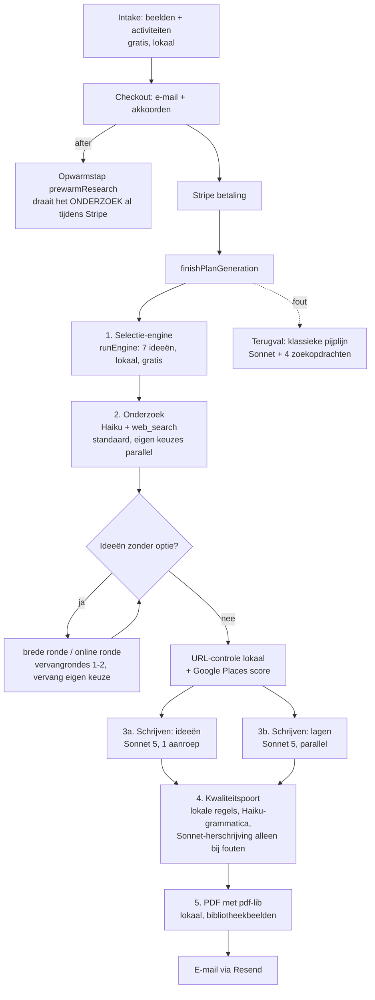
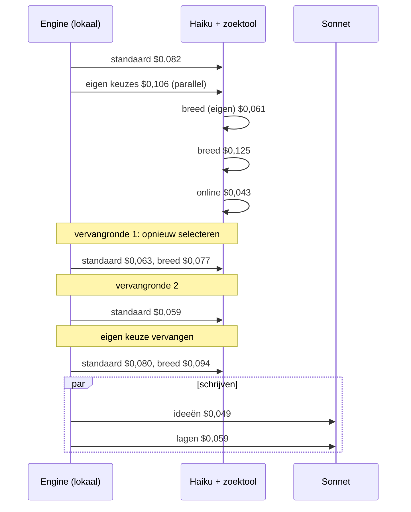
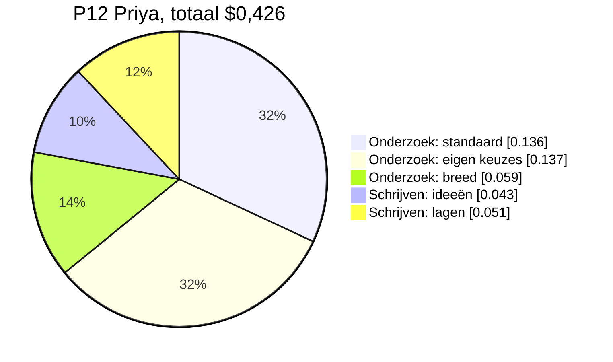
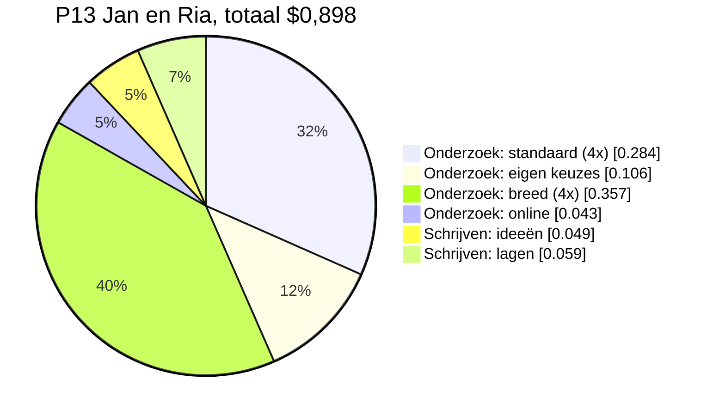

# Kostenonderzoek boekgeneratie (14 november 2026)

Opdracht van Jan: de kosten van één gegenereerd boek substantieel verlagen zonder kwaliteitsverlies, eerst onderzoeken en pas daarna bouwen. **Er is in dit onderzoek geen productiecode gewijzigd en er is geen betaalde aanroep gedaan.** Alle cijfers komen uit de code, uit de eerdere metingen (`docs/discovery-api-costs.md`, de meting van Stap 191 in `scratch/persona-books/`) en uit de Supabase-database. Wat niet gemeten is, staat als zodanig aangegeven.

Zekerheidsniveaus die door het hele rapport worden gebruikt:

- **[B] bewezen**: gemeten in een echte aanroep of rechtstreeks uit de code of database gelezen.
- **[O] onderbouwde raming**: afgeleid uit gemeten cijfers met een expliciete rekensom.
- **[H] hypothese**: nog te testen; er is een experiment voor beschreven.

---

## 1. Managementsamenvatting

1. **Wat een boek kost.** Een vers boek (lege cache) kostte in de twee echte metingen van Stap 191 **$0,43 en $0,90** [B]. Sinds de kostenteller van Stap 193 stoppen de optionele zoekrondes bij $0,40; teruggespeeld op dezelfde twee boeken geeft dat **$0,35 en $0,36** [O, teruggespeeld, niet live gemeten]. Twee eerdere boeken met één onderzoeksronde kostten $0,21-0,22 [B]. Een typisch vers boek rekenen we in dit rapport als **$0,36**.
2. **Waar het geld heen gaat.** In de twee vers gemeten boeken was **78% en 88%** van de kosten *webonderzoek* (Haiku met de Anthropic-zoektool), **12% en 22%** het schrijven (twee Sonnet-aanroepen) [B]. De kwaliteitscontrole is ±1% [O]. Beelden (Gemini) kosten per boek niets: er is geen runtime-aanroep, de beelden zijn vooraf gemaakte bibliotheekbestanden [B, uit de code].
3. **Het onderzoek is duur om twee redenen**: de zoektool kost $0,01 per zoekopdracht én leest per ronde 35-55k tokens zoekresultaat terug; en het boek doet tot tien van zulke rondes achter elkaar (standaard, eigen keuzes, breed, online, vervangrondes) omdat de selectie ideeën kiest *zonder te weten of er aanbod bestaat*. In de onderzoekscache heeft **60% van de standaardantwoorden geen enkele optie** en slaagt **1 op de 10 brede antwoorden** [B, steekproef 605 en 40 rijen].
4. **Drie dingen die nu verborgen zijn en geld kosten of risico geven**:
   - Het kostenrapport van elk boek (`report.cost`) wordt **nergens bewaard**: `plan/data.ts` gebruikt alleen `.book`. Er is dus geen enkele echte productiemeting mogelijk [B].
   - De opwarmstap tijdens het betalen (`prewarmResearch`) betaalt het volledige onderzoek ook voor kopers die niet betalen. Bij 60-80% betaalconversie is dat **$0,07-0,17 extra per betaald boek** [O, conversie onbekend].
   - Google-scores zijn gratis tot 900 opzoekingen per maand en daarna $0,035 per stuk. Dat is **maximaal $0,28 per boek** buiten de kostenteller, en de gratis ruimte is op bij ±110-225 boeken per maand [O].
5. **De generatiekosten zijn klein ten opzichte van de prijs**: $0,36 is ruim 5% van €7,50 (incl. btw). Zelfs de grootste herbouw bespaart ≈ $0,24 per boek (≈ 3% van de prijs). De winst van optimaliseren zit dus vooral in **kwaliteit en risico** (de staart van $0,90-boeken, de verspilling bij afbrekers, de rating-functie die op schaal stilvalt), niet in de gemiddelde kosten.
6. **Aanbeveling** (sectie 9): eerst **meten** (kosten per boek bewaren, dan is het rapport hierna geen schatting meer), dan **supply-bewuste selectie** (kies ideeën waarvan bekend is dat er aanbod is, zodat de dure vervangrondes verdwijnen), en **tekstlagen uit de bibliotheek** in plaats van per boek schrijven. Samen: van ≈ $0,36 naar ≈ $0,17-0,25 per boek (−30% tot −50%) met gelijke of betere kwaliteit [O/H]. Een eigen zoekpijplijn (zoek-API + lokale controle + Haiku) kan naar ≈ $0,10-0,15 maar is pas verstandig bij duizenden boeken per maand.

| Scenario | Kosten per boek (typisch) | Besparing | Ontwikkeling (raming) | Zekerheid |
|---|---|---|---|---|
| Nu (met teller) | $0,36 (grens $0,40) | - | - | [B]/[O] |
| 1. Quick wins | $0,26-0,33 (midden $0,28) | −8% tot −28% | 1-2 dagen | [O]/[H] |
| 2. Structureel | $0,17-0,25 (midden $0,20) | −30% tot −53% | 8-12 dagen | [O]/[H] |
| 3. Herontwikkeling | $0,10-0,15 (midden $0,12) | −58% tot −72% | 25-40 dagen | [H] |

---

## 2. Beschrijving van de huidige generatiearchitectuur

Alles hieronder is gelezen in `src/lib/claude/` en `src/app/plan/data.ts`.

**Modellen en diensten per boek** [B]:

| Dienst | Waarvoor | Betaald per |
|---|---|---|
| Claude Haiku 4.5 + `web_search_20250305` | onderzoek naar echte plekken (`localResearch.ts`) | tokens ($1/$5 per M) + $0,01 per zoekopdracht |
| Claude Sonnet 5 | de ideeën (`create_idea_book`) en de lagen (`create_layers`), twee parallelle aanroepen | tokens ($2/$10 per M) |
| Claude Haiku 4.5 | grammaticacontrole, altijd (`qualityRepair.ts`) | tokens |
| Claude Sonnet 5 | herschrijven van ideeën die een controle missen (max. 2 rondes per idee), alleen bij fouten | tokens |
| Google Places API (New), Text Search Enterprise | score en aantal reviews per plek (`placesRatings.ts`) | 1.000 gratis per maand, daarna $35 per 1.000 |
| Eigen HTTP-controle | bestaat de website nog, klopt de inhoud (`verifyUrls.ts`) | gratis (rekentijd) |
| Gemini "Nano Banana Pro" | beelden | **niet in de boekstroom**: `generateIllustration` heeft geen runtime-aanroeper, alleen scripts |
| pdf-lib, Supabase, Resend | PDF, opslag, e-mail | niet gemeten (zie sectie 3.5) |

**Buiten het boek zelf, wel per bezoeker of koper** [B]: de lezing op het profielscherm (`app/intake/interpret.ts`, Sonnet, ≈ $0,005 per verschillende set keuzes, begrensd op 8 per verbinding per 10 minuten en 400 per uur) en de opwarmstap tijdens het betalen.

**Het sequentiediagram van een zwaar boek** (P13, "Jan en Ria", $0,898 [B]; de balken zijn de kosten per aanroep):

De volgorde is sequentieel omdat elke ronde bepaalt wat de volgende nodig heeft. Dat is ook waarom zo'n boek 100-150 seconden duurt.

---

## 3. Volledige kostenanalyse per boek

### 3.1 Gemeten boeken (vers, lege cache, Stap 191) [B]

| | P12 Priya | P13 Jan en Ria | Gemiddeld |
|---|---|---|---|
| Standaardrondes (aantal) | $0,136 (2) | $0,284 (4) | |
| Eigen keuzes | $0,137 (1) | $0,106 (1) | |
| Brede rondes (aantal) | $0,059 (1) | $0,357 (4) | |
| Online ronde | - | $0,043 (1) | |
| **Onderzoek totaal** | **$0,332 (78%)** | **$0,790 (88%)** | $0,561 (85%) |
| Schrijven: ideeën | $0,043 | $0,049 | |
| Schrijven: lagen | $0,051 | $0,059 | |
| **Schrijven totaal** | **$0,094 (22%)** | **$0,108 (12%)** | $0,101 (15%) |
| **Totaal (modelkosten)** | **$0,426** | **$0,898** | $0,662 |
| Teruggespeeld met de teller van Stap 193 | $0,35 | $0,36 | [O] |

Twee eerdere boeken (P04 en P10, persona-meting vóór Stap 190, elk met één onderzoeksronde; de staat van de cache is niet vastgelegd) kostten $0,217 en $0,213 [B]. Het tweede had **twee ideeënaanroepen** ($0,036 en $0,044): één mislukte schrijfpoging is volledig opnieuw betaald (+17%). Eén boek in vier is te weinig om een frequentie te noemen.

### 3.2 Kosten per aanroeptype [B, uit de 14 gemeten rondes]

| Soort | Aantal gemeten | Spreiding | Gemiddeld |
|---|---|---|---|
| Standaardronde | 6 | $0,059-0,082 | $0,070 |
| Eigen keuzes | 2 | $0,106-0,137 | $0,122 |
| Brede ronde | 5 | $0,059-0,125 | $0,083 |
| Online ronde | 1 | $0,043 | $0,043 |
| Ideeën schrijven | 4 | $0,036-0,049 | $0,043 |
| Lagen schrijven | 4 | $0,051-0,059 | $0,055 |

### 3.3 Samenstelling van één aanroep [O, één gedocumenteerd voorbeeld uit `docs/discovery-api-costs.md` §5]

Een onderzoeksronde van 7 activiteiten: 5 zoekopdrachten × $0,01 = **$0,050 (54%)**, 35k tokens zoekresultaat terug als input × $1/M = **$0,035 (38%)**, 1,4k tokens output × $5/M = **$0,007 (8%)**; samen $0,092. De gemeten rondes van Stap 191 lagen lager ($0,059-0,082), dus de verhouding is indicatief.

Schrijven: de ideeënaanroep heeft 5,3k tokens input ($0,011) en 3,1k tokens output ($0,031): **75% van de kosten is output**. Het inkorten van prompts of systeemteksten levert dus bijna niets op (1.000 tokens input = $0,002); alleen minder gegenereerde tekst of een goedkopere aanroep voor die tekst telt.

### 3.4 Vast, variabel, vermijdbaar

| Kostenpost | Per boek | Soort | Waarom |
|---|---|---|---|
| Eerste onderzoeksronde (standaard + eigen keuzes) | ≈ $0,19 | variabel, grotendeels onvermijdbaar | zonder dit geen echte plekken |
| Schrijven (ideeën + lagen) | ≈ $0,094-0,108 | variabel; de lagen zijn deels **vermijdbaar** (§5.2) | tekst per persoon |
| Brede ronde, online ronde, vervangrondes | $0,04-0,60 | variabel, **vermijdbaar** met supply-bewuste selectie | herstellen van een selectie die geen aanbod kende |
| Grammaticacontrole (Haiku) | ≈ $0,005 | vast | nodig, goedkoop |
| Herschrijfrondes (Sonnet) | onbekend, alleen bij fouten | variabel | frequentie niet gemeten |
| Mislukte schrijfpoging (retry) | +$0,036-0,044 per keer | **vermijdbaar** | 1 keer gezien in 4 boeken |
| Google-score | $0 binnen 900/maand, daarna ≤ $0,28 | verschuiving (§4.5) | buiten de teller |
| Opwarmstap voor afbrekers | $0,07-0,17 per betaald boek | **vermijdbaar** (deels) | §4.4 |
| Lezing profielscherm | ≈ $0,005 / conversie | vast per bezoeker | vóór de aankoop |

### 3.5 Wat niet gemeten is

- **Alle productiegegevens ontbreken.** De database heeft 2 betalingen (beide `pending`) en 3 boeken [B]. Betaalconversie, aantal retries, herschrijfrondes en cachetreffers in productie zijn onbekend.
- **Tokenaantallen per aanroep** zijn alleen voor één voorbeeld gedocumenteerd (§3.3); de metingen van Stap 191 bewaren per aanroep alleen de kosten.
- **Het kostenrapport per boek** wordt na generatie weggegooid (`plan/data.ts` leest alleen `.book`).
- **De prijzen in de code** ($2/$10 Sonnet 5, $1/$5 Haiku 4.5, $0,01 per zoekopdracht) zijn nooit naast een Anthropic-factuur gelegd. Dat is de eerste controle die geld oplevert aan zekerheid.
- **Vercel-rekentijd, Stripe-kosten en btw** vallen buiten de generatie en zijn hier niet doorgerekend.

---

## 4. Analyse van inefficiënties en kostenveroorzakers

### 4.1 Selectie zonder kennis van aanbod

De engine kiest 7 ideeën; daarna blijkt of er aanbod bestaat. De cache laat zien hoe vaak dat misloopt [B, 890 rijen]:

| Soort antwoord | Rijen | Met minstens één optie |
|---|---|---|
| Standaard | 605 | 242 (**40%**) |
| Eigen keuzes | 98 | 44 (45%) |
| Online | 147 | 73 (50%) |
| Breed | 40 | 4 (**10%**) |

Ruim de helft van de zoekopdrachten voor een activiteit levert dus niets op, en een brede ronde slaagt zelden. Elke mislukking wordt gevolgd door een nieuwe ronde: dat is hoe P13 op tien rondes kwam. Let op: het zijn testgegevens (19 plaatsen, vooral Laren en Utrecht, verschillende promptversies), geen echt verkeer.

### 4.2 De cache is versnipperd [B]

Een cachesleutel bevat `plaats | straal | maand | promptversie | praktische wensen | soort (eigen/breed/online)`. De straal heeft acht stappen (5, 10, 15, 25, 50, 75, 100, 150 km), elk een eigen sleutel: voor Laren staan vier straalvarianten in de cache. De versie is al van v2 naar v6 gegaan; elke ophoging maakt alle eerdere rijen onbruikbaar (nu 890 rijen uit 39 sleutelgroepen voor 19 plaatsen). De maand zit in de sleutel, dus alles verloopt op de 1e, ook al is de TTL 30 dagen. Een leeg antwoord geldt maar 7 dagen. De gesimuleerde treffer-kans is 5-9% bij 100-300 boeken en ±24% bij 1.000 boeken (`docs/discovery-api-costs.md` §4); met minder fragmentatie is die kans hoger [H].

### 4.3 Dure, serieel gekoppelde rondes

De brede ronde, de online ronde en twee vervangrondes bestaan om een slechte selectie te herstellen (§4.1). De teller van Stap 193 begrenst dat, maar herstelt niet de oorzaak: onder de grens vallen de rondes weg en wordt een idee zonder optie vervangen door een ander uit eerdere rondes of eerlijk als "zoek zelf op Google Maps" geschreven. Dat is veilig maar niet de beste kwaliteit.

### 4.4 De opwarmstap

`prewarmBookResearch` start in `after()` van `createCheckoutSession`, draait het onderzoek tot en met de vervangrondes (niets wordt geschreven) en vult de cache vóór de betaling klaar is. Het scheelt 15-40 s wachttijd. Voor iedere koper die daarna niet betaalt, is dat onderzoek weggegooid geld. De verspilling per **betaald** boek is `(1/c − 1) × p`, met `c` de conversie op de Stripe-pagina en `p` de kosten van het opgewarmde onderzoek:

| Conversie c | p = $0,19 (alleen eerste ronde) | p = $0,26 (volledig onderzoek) |
|---|---|---|
| 40% | $0,29 | $0,39 |
| 60% | $0,13 | $0,17 |
| 80% | $0,05 | $0,07 |

(Rekensom [O]; `c` is onbekend; `p` uit de teruggespeelde boeken.) Er is ook een risico op dubbele betaling: betaalt iemand binnen enkele seconden, dan start de echte generatie terwijl de opwarmstap nog zoekt en de cache nog leeg is. Of dat gebeurt, is niet gemeten.

### 4.5 Google-scores: een verschuiving, geen besparing

Het onderzoek zelf zoekt geen scores meer (Stap 192); `placesRatings.ts` doet per plek één Text Search (Enterprise-SKU) met een maandteller. [B, Google-prijslijst gelezen en bevestigd met een nieuwe zoekopdracht: Text Search Enterprise 1.000 gratis per maand, daarna $35 per 1.000; de Pro-SKU heeft geen rating-velden.]
- Maximaal 8 opzoekingen per boek, ≤ 2 per activiteit, plekken uit de cache worden niet opnieuw opgezocht.
- De teller stopt bij 900 per maand: **dan krijgen boeken stilletjes geen scores meer.** Bij 4-8 opzoekingen per boek is dat na ≈ 110-225 verse boeken per maand; de cache stelt dat uit.
- Zet je `GOOGLE_PLACES_ALLOW_PAID=1`, dan kost het tot **$0,28 per boek** bovenop de modelkosten. Dat past niet bij de wens van Jan van $0,40 totaal ($0,36 + $0,28 = $0,64). De teller (`costLedger.ts`) kent deze kosten niet.

### 4.6 Overige bevindingen [B]

- **Dubbele input.** De twee schrijfaanroepen sturen dezelfde profiel- en optietekst (±2-3k tokens) elk apart. Samenvoegen bespaart ≈ $0,005-0,01 maar kost wachttijd (de eerdere samengevoegde aanroep duurde 65 s en liep tegen de tijdslimiet aan). Prompt caching helpt niet: de systeemprompts verschillen en de aanroepen lopen tegelijk.
- **Terugval op de klassieke pijplijn.** Faalt de seed-pijplijn ná het onderzoek (bijvoorbeeld twee mislukte schrijfpogingen), dan draait `generateIdeaBook` helemaal opnieuw met Sonnet en vier zoekopdrachten (≈ $0,22, `docs/discovery-api-costs.md`), zonder de cache. Het onderzoek wordt dus twee keer betaald. Frequentie onbekend.
- **De kostenteller mist** de kwaliteitspoort (±$0,005), de Places-opzoekingen en de opwarmstap (eigen teller).
- **De bibliotheek bevat al** per activiteit kosten-klasse, duur, intensiteit, niveau, seizoen en een instap-tekst (`Activity` in `src/lib/discovery/types.ts`): de grondstof voor tekst per activiteit is er.

---

## 5. Technische optimalisatiemogelijkheden

Per mogelijkheid: wat is het, wat levert het, wat kost het in kwaliteit. "Soort" is: **B**esparing (minder werk), **V**erschuiving (kosten elders), **E**fficiëntiewinst (zelfde werk goedkoper).

### 5.1 Meten (Fase 0, geen besparing maar voorwaarde)

| # | Maatregel | Soort | Effect | Zekerheid |
|---|---|---|---|---|
| M1 | `report.cost` bewaren per boek in `progress_meta` (bestaande jsonb-kolom, geen migratie) en de teller uitbreiden met Places en de kwaliteitspoort | - | alle volgende cijfers worden echt | [B] haalbaar |
| M2 | Maandtotaal van de teller naast de Anthropic-factuur leggen | - | controleert de prijsconstanten | [B] |
| M3 | Betaalconversie van Stripe en retryfrequentie uit de Vercel-logs halen | - | maakt §4.4 en §4.6 rekenbaar | [B] |

### 5.2 Groeperen, hergebruiken, lokaal (schrijven)

| # | Maatregel | Soort | Effect per boek | Kwaliteit | Zekerheid |
|---|---|---|---|---|---|
| W1 | **Lagen op Haiku** (`create_layers`: sfeer, drie maten, volgende stap, tijdlijn, afhaalpunten, tips) | E | −$0,028 (Haiku is de helft van de Sonnet-prijs) | risico: Nederlands taalgevoel (bij de lezing op het profielscherm gleed het goedkope model uit in de eerste echte test, zie `interpret.ts`); blind testen | [O]/[H] |
| W2 | **Lagen per activiteit vooraf schrijven** in de bibliotheek (eenmalig, Batch API −50%), per boek alleen kiezen | B | −$0,051 laag-aanroep, +$0,006 voor de maten in de ideeënaanroep: netto **−$0,045** | gelijk of beter: Jan kan de ± 700 activiteiten één keer nalezen; verlies: de tekst wordt niet door de gekozen beelden gekleurd | [O]/[H] |
| W3 | Prompts korten | - | ≈ −$0,002 per 1.000 tokens | n.v.t. | [B] niet de moeite |
| W4 | Twee aanroepen samenvoegen | - | −$0,005-0,01, wachttijd stijgt | negatief | [B] verworpen |
| W5 | Herschrijfrondes alleen op de zwaarste regels | B | onbekend (frequentie onbekend) | neutraal | meten (M1) |

W2 in cijfers: 700 activiteiten × 2 talen × ≈ 600 tokens output = 0,84M tokens. Met Sonnet-Batch ($5/M output) ≈ **$4-5 eenmalig**; met een nalees- en verbeterronde ruim onder $20 [O]. De lagen waar een plek of prijs in voorkomt (maten met kosten, "{FREE}") blijven per boek: de sfeerzin ("alleen wat waar is voor dit soort activiteit, geen plaatsnaam, geen prijs") en de tijdlijn, afhaalpunten en tips zijn al per definitie activiteit-breed. Dat is geen aanname maar de huidige promptregel (`LAYERS_SYSTEM_PROMPT`).

### 5.3 Onderzoek: minder rondes

| # | Maatregel | Soort | Effect per boek | Kwaliteit | Zekerheid |
|---|---|---|---|---|---|
| R1 | **Supply-bewuste selectie**: een aanbodindex uit de cache (activiteit × regio → had opties) en een lage score voor activiteiten waar bekend is dat het stil blijft | B | de brede, online en vervangrondes vallen weg bij ≈ 60% van de boeken: −$0,07 tot −$0,15 (onder de teller: kwaliteit stijgt in plaats van dat een ronde wordt overgeslagen) | beter: minder "zoek zelf op Google Maps" | [O]/[H] |
| R2 | **Cachehygiëne**: straal naar 3 emmers (stad, regio, land), maand uit de sleutel (alleen TTL), promptversie niet laten bepalen of oude antwoorden bruikbaar zijn als alleen de formulering veranderde, lege antwoorden 30 dagen in plaats van 7 | B | hogere treffer-kans: −$0,015 tot −$0,06 bij 100-1.000 boeken | neutraal; risico: een nieuwe aanbieder wordt later gevonden (leeg 30 dagen) | [O]/[H] |
| R3 | **Opwarmstap alleen de eerste ronde** | B | $0,03-0,07 per betaald boek (afhankelijk van `c`, §4.4) | boek duurt 15-40 s langer | [O]/[H] |
| R4 | **Minder zoekopdrachten per ronde** (standaard max 5 → 4, eigen keuzes max 4 → 3) | B | ≈ −$0,017-0,02 per vermeden zoekopdracht (fee + resultaten), ≈ −$0,035 bij twee rondes | onbekend: het aantal gevonden opties per idee moet gemeten | [H] |
| R5 | `web_search_20260209` (dynamische filtering) opnieuw proberen: in november faalde die met "tool use limit exceeded", de besparing in dat experiment was −32% | E | tot −30% op onderzoek | gelijk (zelfde zoektool) | [H], experiment van ± $0,20 |
| R6 | Retry en terugval: bij een mislukte schrijfpoging na afgerond onderzoek opnieuw schrijven in plaats van de klassieke pijplijn | B | alleen in de staart, −$0,22 per terugval | neutraal | meten (M3) |

### 5.4 Wat al goed is (niet aanpassen)

Groeperen per ronde, gedeelde cache, Haiku voor onderzoek, lokale URL-controle, lokale kwaliteitsregels vóór de modellen, de teller en de Places-teller, retry zonder opnieuw onderzoek, Batch niet voor live boeken (de koper wacht). Dit zijn de uitkomsten van de eerdere stappen en blijven staan.

---

## 6. Out-of-the-box alternatieven

| # | Idee | Eerlijke beoordeling | Haalbaarheid | Complexiteit | Kwaliteitsimpact |
|---|---|---|---|---|---|
| A | **Eigen zoekpijplijn**: een zoek-API (Serper ≈ $1 per 1.000, Brave ≈ $5 per 1.000, volgens vergelijkingssites, niet geverifieerd bij de leverancier) voor 14 zoekopdrachten uit `searchHints` (zonder model), de pagina's lokaal ophalen (de bestaande `verifyUrls.ts` doet dat al), één Haiku-aanroep die uit de tekstfragmenten het JSON-antwoord haalt | Vervangt $0,01 per zoekopdracht plus 35-55k tokens teruglezen door $0,014-0,07 + ± $0,02. Onderzoek $0,33 → $0,04-0,09 [H] | goed, bouwt voort op bestaande code | hoog (nieuwe leverancier, cache, tests, wijziging van de vastgestelde techstack: overleg) | onbekend: kwaliteit van de zoekresultaten (andere index dan Anthropic's tool); A/B-meting nodig |
| B | **Google Places als ontdekkingsbron** (Text Search per activiteit): geeft naam, adres, website, status, rating | Gelijk aan wat we nu per plek doen, maar dan per activiteit: 7 × $0,035 = $0,245 buiten de gratis 1.000. Niet goedkoper dan nu; alleen zinvol binnen het gratis tegoed of als validatie | beperkt | middel | goed voor bestaan en rating, maar vindt geen "proefles voor beginners" |
| C | **Goedkoper model voor extractie** (Gemini 2.5 Flash-Lite ≈ $0,10 / $0,40 per M, Flash ≈ $0,30 / $2,50; volgens vergelijkingssites; Google zou de 2.5-modellen per oktober 2026 uitfaseren, dus controleer eerst de actuele naam en prijs) | Tokens zijn 10× goedkoper dan Haiku, maar de zoek-fee en de teruggelezen resultaten (de grootste posten) blijven; zoek-grounding heeft een eigen prijs die ik niet heb kunnen verifiëren | middel | hoog (tweede leverancier, ander gedrag) | onbekend |
| D | **Open-source model lokaal** (Llama, Mistral) | Voor tussen 100 en 5.000 boeken per maand is een eigen GPU-server vrijwel zeker duurder dan de ± $0,06-0,10 aan tokens per boek; Nederlandse tekstkwaliteit lager; Vercel kan het niet hosten. Alleen voor classificatietaken denkbaar | laag | zeer hoog | negatief voor tekst |
| E | **Aanbodindex uit eerdere boeken** (supply-index) | Zie R1: gratis, uit de eigen cache; wordt beter naarmate er meer boeken zijn | hoog | laag-middel | positief |
| F | **Hete-cellen-opwarming**: vooraf (Batch, −50%) het aanbod van de tien grootste plaatsen × de ±150 meest gekozen activiteiten (±1.500 cellen ≈ 210 rondes ≈ $19 standaard, ≈ $10 via Batch, mits de zoektool in Batch werkt: niet geverifieerd) laten onderzoeken | Alleen zinvol als de vraag geconcentreerd is; dat weten we pas na lancering | middel | middel | positief (snel, gecontroleerd) |
| G | **Open data voor buitenactiviteiten** (OpenStreetMap/Overpass: sportcentra, musea, natuurgebieden met website en openingstijden, gratis) | Dekt een deel van de activiteiten (sport, natuur, musea) gratis; dekt workshops en clubs slecht en heeft geen reviews | middel | middel | neutraal voor wat het dekt |
| H | **Deterministische samenstelling van de "gewone" velden** (kosten, duur, moeilijkheid uit de bibliotheekklasse in plaats van door het model) | Het model schrijft nu `practical`; de bibliotheek heeft kosten-klasse en duur. Bespaart weinig output (±150 tokens ≈ $0,0015) | hoog | laag | risico: minder plaatsgebonden prijzen |
| I | **Template-tekst per activiteit voor titels** | Verworpen: titels moeten waar zijn voor de gevonden plek (Stap 190); dat vraagt het model | - | - | negatief |

---

## 7. Analyse van kwaliteitsbehoud en kwaliteitsverbetering

### 7.1 Wat behouden moet blijven en hoe het nu wordt bewaakt

| Aspect | Huidige bewaking |
|---|---|
| Inhoudelijke juistheid, echte plekken | URL-controle op bestaan en inhoud; `location_not_in_research`; `title_place`; plekken uit het onderzoek, nooit verzonnen; Places-status `CLOSED_PERMANENTLY` valt uit het boek |
| Diepgang, samenhang, personalisatie | `why_it_fits` per idee uit de "Why it was chosen"-regel; lagen per idee; herhaalcontrole (`repeated_sentence`, `fill_repetitive`) |
| Taal | grammaticapas (Haiku) met taalcontrole die een vertaling weigert; `autoFix` |
| Originaliteit en variatie | `E3` herhaling, spreiding over werelden, `fill_repetitive` |
| Bronnen, feiten | `addsNoFacts` (een herschrijving mag geen URL, prijs of getal toevoegen), `unverified_website` |
| Visueel | vaste PDF-opmaak met bibliotheekbeelden; geen modelkosten, dus niet geraakt door deze optimalisaties |

Het bestaande meetkader (`docs/eval/README.md`, `scripts/eval/run.ts`, 20 vaste profielen, blinde A/B-sheets, harde regels, `qaBook`-codes, persona-boeken) is bruikbaar zonder nieuwe bouw.

### 7.2 Effect per maatregel

| Maatregel | Effect op kwaliteit | Hoe te toetsen |
|---|---|---|
| R1 supply-bewuste selectie | Positief: meer ideeën met een echte optie, minder "zoek zelf op" | aandeel ideeën met optie (nu 7/7 na rondes) en aandeel dat zonder vervangen idee slaagt |
| R2 cachehygiëne | Neutraal; risico op een verouderd antwoord | steekproef gecachete antwoorden tegenover vers onderzoek |
| R3 opwarmen beperken | Neutraal (andere timing) | wachttijd per fase |
| R4 minder zoekopdrachten | Mogelijk negatief | gevonden opties per idee en score op `title_place` |
| W1 lagen op Haiku | Risico op taal | blinde vergelijking (Jan), grammaticapas-fixes tellen, `languageGuess` |
| W2 lagen uit bibliotheek | Positief voor consistentie, licht negatief voor kleuring door beelden | blind; Jan leest de ± 700 teksten één keer |
| A eigen zoekpijplijn | Onbekend, de grootste kans en het grootste risico | volledige A/B op 20 profielen |

### 7.3 Objectief testkader (voorstel)

Een variant is geslaagd als, op dezelfde 20 profielen (`scripts/eval/profiles/`) met dezelfde maand:

1. de harde regels (E1, E3-E6) en duplicaten blijven **0**;
2. het aandeel ideeën met een gevonden optie is **gelijk of hoger** dan de basis (nu 100% na vervangrondes);
3. `title_place` en `qa_remaining` zijn **gelijk of lager**;
4. het aantal grammatica-fixes en taalafwijkingen is **gelijk of lager**;
5. de blinde vergelijking (5 rubricvragen, Jan en twee testers) staat **niet slechter dan gelijk**;
6. kosten en seconden worden uit de teller gelezen (M1), niet geschat.

Kosten van zo'n toets: 20 profielen × 2 varianten ≈ 40 boeken × ≈ $0,30 = **≈ $12** [O]. Voor een deelronde (10 profielen, één variant, hergebruik van de cache van de basis) ≈ $4-6. Geen enkele daarvan wordt gedraaid zonder Jans akkoord op het bedrag.

---

## 8. Financiële scenarioanalyse

**Aannames.** Basis = $0,36 per vers boek (teruggespeelde P12/P13, §3.1), de grens is $0,40. De ontwikkelkosten zijn een raming in dagen; de waarde per uur (€60) is een **aanname die Jan zelf moet invullen**. De prijs is €7,50 incl. btw. Alles per *gegenereerd* boek, zonder de opwarmverspilling en de Places-kosten (die staan apart in §4.4 en §4.5).

### 8.1 Scenario's

| | Nu | 1. Quick wins | 2. Structureel | 3. Herontwikkeling |
|---|---|---|---|---|
| Wat | huidig + teller | M1-M3, W1, R4, deel van R2, R3 | scenario 1 minus W1, plus R1, W2, volledige R2, R5, M-meters | scenario 2 plus A (eigen zoekpijplijn), F |
| Kosten per boek | $0,36 | $0,26-0,33 (midden $0,28) | $0,17-0,25 (midden $0,20) | $0,10-0,15 (midden $0,12) |
| Besparing absoluut | - | $0,03-0,10 | $0,11-0,19 | $0,21-0,26 |
| Besparing procentueel | - | 8-28% | 30-53% | 58-72% |
| Generatietijd | 50-150 s | gelijk of iets langer (R3) | korter: de seriële vervangrondes vallen weg, 40-70 s [H] | korter; zoekopdrachten parallel [H] |
| Effect op kwaliteit | - | W1 en R4 kunnen kwaliteit kosten (testen) | R1 en W2 verbeteren; R2 neutraal | afhankelijk van de zoekkwaliteit van A (A/B nodig) |
| Eenmalig, ontwikkeling | - | 1-2 dagen | 8-12 dagen | 25-40 dagen |
| Eenmalig, toetsing (USD) | - | $4-6 | $12-16 | $25-35 |
| Beheer | - | zeer laag | laag (aanbodindex en bibliotheek bijhouden) | middel (tweede leverancier, bewaking zoekkwaliteit) |
| Complexiteit | - | laag | middel | hoog |
| Zekerheid | - | [O]/[H] | [O]/[H] | [H] |

De rekensommen:
- Quick wins: W1 −$0,028; R4 −$0,035 (twee rondes × één zoekopdracht × ≈ $0,0175); R2 −$0,015 bij lanceringsvolume. Laag geval: alleen W1 slaagt (−$0,03). Hoog geval: alles −$0,10.
- Structureel: R1 −$0,07 (de optionele ronde van de teruggespeelde boeken: $0,26 onderzoek − $0,19 eerste ronde); W2 −$0,045; R2 volledig −$0,04 (research $0,19 × 20% treffers); R4 −$0,035 als die slaagt. Laag geval $0,36 − $0,115 = $0,245; hoog geval $0,36 − $0,19 = $0,17.
- Herontwikkeling: onderzoek $0,04-0,09 (14 zoekopdrachten × $0,001-0,005 + ± $0,02 Haiku, bij 12-15k tokens in en 1,5k uit), ideeënaanroep $0,049, kwaliteitspoort $0,005, Places binnen de gratis ruimte $0: totaal $0,094-0,144.

### 8.2 Besparing per productievolume (midden van de scenario's, t.o.v. $0,36)

| Boeken per maand | Totale modelkosten nu | 1. Quick wins (−$0,08) | 2. Structureel (−$0,16) | 3. Herontwikkeling (−$0,24) |
|---|---|---|---|---|
| 100 | $36 | $8 | $16 | $24 |
| 500 | $180 | $40 | $80 | $120 |
| 1.000 | $360 | $80 | $160 | $240 |
| 5.000 | $1.800 | $400 | $800 | $1.200 |

Ter vergelijking: 1.000 boeken × €7,50 = €7.500 omzet. Scenario 3 bespaart bij 1.000 boeken ≈ 3% daarvan.

### 8.3 Terugverdientijd

| | Eenmalig (contant, toetsing) | Eenmalig (ontwikkeltijd à €60/uur, 8 u/dag) | Boeken om de toetsing terug te verdienen | Boeken om ook de ontwikkeltijd terug te verdienen |
|---|---|---|---|---|
| 1 | $5 | 1,5 dag = €720 | ≈ 60 | ≈ 9.000 |
| 2 | $14 | 10 dag = €4.800 | ≈ 90 | ≈ 30.000 |
| 3 | $30 | 32 dag = €15.360 | ≈ 125 | ≈ 64.000 |

(Contante kosten delen door de besparing per boek uit §8.2; euro en dollar zijn voor deze grove vergelijking gelijkgesteld.)

**Wat dit betekent.** Het cash-deel van de toetsing is in enkele honderden boeken terugverdiend. De ontwikkeltijd, tegen een marktuurtarief, verdient zichzelf op de kosten alleen terug bij tienduizenden boeken. Dat is geen reden om niets te doen, maar wel om de maatregelen te kiezen die ook kwaliteit of risico verbeteren (R1, W2, M1), en de herbouw (scenario 3) niet te kiezen om de kosten alleen. Is de ontwikkeltijd bijna gratis (Claude Code onder een abonnement), dan ziet de rekening er anders uit; dat is aan Jan.

### 8.4 Het risico dat de gemiddelden verbergen

De staart is groter dan het gemiddelde: P13 kostte $0,90 vóór de teller; zonder teller zijn $0,90+ boeken een rekening die niet bij het gemiddelde past. De teller is daarom de belangrijkste besparing van het hele project geweest (−$0,54 op dat ene boek, −$0,08 op het andere, teruggespeeld); hij blijft staan in alle scenario's. Daarnaast is het Places-risico (§4.5) een plafond van $0,28 per boek dat bij schaal alsnog tegen de $0,40-wens aan komt.

---

## 9. De drie meest kansrijke benaderingen

| Rang | Benadering | Besparing | Kwaliteit | Haalbaarheid | Tijd | Schaalbaarheid | Onderhoud | Risico |
|---|---|---|---|---|---|---|---|---|
| 1 | **Meten + supply-bewuste selectie en cache** (M1-M3, R1, R2, R3) | −$0,07 tot −$0,15 + minder verspilling bij afbrekers | **beter** | hoog | 1-3 weken | verbetert met volume | laag | laag |
| 2 | **Tekstlagen uit de bibliotheek** (W2; W1 als tussenstap) | −$0,045 (W2) | gelijk of beter, geen kleuring door beelden | hoog | 1-2 weken | onbeperkt | middel (nalezen, bijwerken) | laag-middel |
| 3 | **Eigen zoekpijplijn** (A, F) als experiment | −$0,20 tot −$0,26 | onbekend | middel | 4-8 weken | goed | middel | middel-hoog |

Per benadering:

**1. Meten + supply-bewuste selectie.** *Direct*: M1 (kosten per boek in `progress_meta`, geen migratie), M2, M3 (conversie en retries uit Stripe en de logs); R3 omschakelen op één env-variabele (`PREWARM_RESEARCH` bestaat al, een "alleen eerste ronde"-stand is een kleine aanpassing). *Eerst testen*: R1, een aanbodindex uit `local_research_cache` die de selectie gebruikt als zachte straf; meet op de 20 profielen of er minder brede en vervangrondes nodig zijn; R2 stap voor stap (eerst straalemmers, dan lege-TTL). *Grotere wijziging*: de index per regio bijhouden en de promptversie-ophoging zo inrichten dat oude antwoorden bruikbaar blijven.

**2. Tekstlagen uit de bibliotheek.** *Direct*: W1 testen op 10 profielen (blind) als tussenoplossing. *Eerst testen*: W2 voor 20 activiteiten laten schrijven (Batch, ≈ $0,15), Jan leest ze en vergelijkt blind met de huidige per-boek-versie. *Grotere wijziging*: ± 700 activiteiten × 2 talen vooraf, een nalees- en bijwerkproces (er komen nieuwe activiteiten bij), en de `create_layers`-aanroep alleen nog voor wat plaatsgebonden is of helemaal laten vervallen.

**3. Eigen zoekpijplijn.** Alleen als het volume duizenden boeken per maand wordt, of als de Anthropic-zoektool in prijs of kwaliteit verandert. *Eerst testen*: 10 profielen, de nieuwe pijplijn naast de huidige, dezelfde meetlat (§7.3); budget ≈ $25. *Grotere wijziging*: een zoek-API-contract, een eigen cache op URL-niveau en een aanpassing van de vastgestelde techstack, wat overleg vraagt.

**Versterking en botsing.**
- 1 en 2 versterken elkaar: met de aanbodindex is de eerste ronde genoeg, en met bibliotheekteksten is het schrijven de enige per-boekkost die overblijft.
- 1 maakt de teller minder vaak nodig, maar hij blijft als vangnet (ook bij 3).
- W1 en W2 sluiten elkaar uit: kies W2; W1 is alleen een tussenstap.
- R3 (lichte opwarming) en een volledige opwarmstap sluiten elkaar uit; met R1 wordt de verspilling bij afbrekers toch kleiner.
- 3 raakt Places (beide halen "bewijs" uit externe bronnen): bepaal vooraf welke bron de score en welke het bestaan levert, anders betaal je beide.

---

## 10. Implementatie- en prioriteitenplan

Geordend op verhouding besparing / kwaliteitsrisico / inspanning. Bij het opstellen van dit rapport was niets gebouwd; niets wordt gebouwd zonder Jans akkoord.

**Stand van uitvoering (14 november 2026, Stap 195).** Jan koos adviespunt 1 en 2: M1 (kosten per boek bewaren), R1 (aanbodindex in de selectie) en R2 (cachehygiëne) zijn gebouwd; zie het changelog voor wat en hoe getest. Twee keuzes wijken af van de tekst hierboven, met reden: (a) R2 gebruikt geen drie straalemmers maar hergebruik per straal in één richting (gevonden binnen een kleinere straal telt ook voor een grotere, "niets binnen een grotere straal" ook voor een kleinere), omdat een emmer iemand met 5 km opties van 25 km zou geven; (b) lege antwoorden gelden 14 dagen, niet 30: de meeste lege antwoorden zijn een te dun zoekbudget, en wat ze opleverden blijft bewaard voor de aanbodindex. R3 (opwarmstap beperken) blijft liggen tot de betaalconversie (M3) bekend is; M2 en M3 zijn aan Jan. Het effect op de kosten is nog niet gemeten: dat kan pas als boeken hun kosten bewaren (M1) en de cache met echt verkeer gevuld is.

### Fase 1: direct uitvoerbaar (week 1)

| # | Stap | Inspanning | Verwacht effect | Kwaliteitsrisico |
|---|---|---|---|---|
| 1 | M1: `report.cost` in `progress_meta` bewaren; teller uitbreiden met kwaliteitspoort en Places | 0,5 dag | maakt elke volgende stap meetbaar | geen |
| 2 | M2: de prijsconstanten naast de Anthropic-factuur leggen | 1 uur (Jan) | bevestigt $2/$10, $1/$5, $0,01 | geen |
| 3 | M3: betaalconversie (Stripe) en retryfrequentie (Vercel-logs) ophalen | 1 uur (Jan) | bevestigt of §4.4 en §4.6 ertoe doen | geen |
| 4 | Kleine aanpassingen zonder kwaliteitseffect: een ongewijzigd gebleven promptversie hoeft de cache niet te wissen; lege antwoorden 14 dagen | 0,5 dag | −$0,01 | zeer laag |
| 5 | Toetsronde W1 en R4 op 10 profielen (≈ $5, **akkoord op het bedrag nodig**) | 1 dag | beslist over W1, R4 | meten |

### Fase 2: middellange termijn (week 2-6)

| # | Stap | Inspanning | Effect |
|---|---|---|---|
| 6 | R1: aanbodindex uit de cache, zachte straf in de selectie; meten op de 20 profielen | 3-5 dagen | −$0,07 tot −$0,15, betere boeken |
| 7 | R2: straalemmers, maand uit de sleutel, stabielere versies | 2-3 dagen | −$0,015 tot −$0,06 |
| 8 | R3: opwarmstap tot de eerste ronde beperken (afhankelijk van M3) | 0,5 dag | $0,03-0,07 per betaald boek |
| 9 | W2: lagen voor 20 activiteiten, blind vergelijken; bij goed resultaat de rest | 3-4 dagen | −$0,045 |
| 10 | R5: dynamische-filtering-zoektool opnieuw testen (≈ $0,20) | 0,5 dag | tot −30% op onderzoek |
| 11 | Places begrenzen op schaal: max. 3 opzoekingen per boek, alleen voor de eerste optie van de ideeën waar de titel op leunt | 1 dag | houdt de $0,40-wens haalbaar boven de gratis ruimte |

### Fase 3: lange termijn (maand 2-4, pas na lancering en gemeten volume)

| # | Stap | Inspanning | Effect |
|---|---|---|---|
| 12 | A: eigen zoekpijplijn als experiment, alleen bij duizenden boeken per maand of een gewijzigde Anthropic-prijs | 25-40 dagen | −$0,20 tot −$0,26 |
| 13 | F: hete-cellen-opwarming, gebaseerd op de echte vraag uit M1 | 5 dagen | snelheid en kosten voor populaire plaatsen |
| 14 | G: OpenStreetMap voor buitenactiviteiten | 5-8 dagen | gratis dekking voor een deel van de activiteiten |

---

## 11. Eindconclusie

1. **Realistische inschatting**: van $0,36 (grens $0,40) naar **$0,17-0,25 per boek** met de maatregelen van fase 1-2 (−30% tot −50%), mits de toetsing laat zien dat de kwaliteit gelijk blijft. Een verdere daling naar ≈ $0,10-0,15 is mogelijk maar [H] en alleen gerechtvaardigd bij hoge volumes.
2. **De belangrijkste besparing zat al in de teller** van Stap 193 (−$0,54 op het duurste gemeten boek). De volgende stap is niet bezuinigen maar **meten**: nu is elke kostenclaim een teruggespeelde schatting omdat het rapport per boek wordt weggegooid.
3. **De grootste vermijdbare kostenposten** zijn de rondes die een selectie zonder aanbodkennis herstellen (R1), de opwarmverspilling bij afbrekers (R3, afhankelijk van een nog onbekende conversie) en de lagen die per boek worden geschreven terwijl ze activiteit-breed zijn (W2).
4. **Wat niet zinvol is**: lokale open-source modellen, het samenvoegen van de twee schrijfaanroepen, het korten van prompts, het opnieuw bedenken van titels met templates.
5. **Schaalrisico dat niet in de kostenteller zit**: de Google-score. Boven ± 110-225 verse boeken per maand verdwijnen de scores stilletjes, of kosten ze tot $0,28 per boek. Dit moet vóór de lancering een bewuste keuze worden (fase 2, stap 11).
6. **Eerlijk over de omvang**: de generatie is ≈ 5% van de verkoopprijs. Elke maatregel hierboven doet er verstandig aan ook kwaliteit of risico te verbeteren, anders verdient hij bij de huidige volumes zijn ontwikkeltijd niet terug.

**Open vragen voor Jan** (zijn eigen keuzes): welk uurtarief rekenen we voor ontwikkeltijd; is het akkoord voor ≈ $5 voor de toetsronde van W1 en R4; moet de Google-score op schaal blijven (en dan binnen welke kosten).

### Bronnen buiten de code

Prijzen van alternatieven komen uit vergelijkingssites en zijn niet bij de leverancier gecontroleerd; controleer ze vóór een besluit.

- Anthropic, [prijzenpagina](https://docs.claude.com/en/docs/about-claude/pricing): web search $10 per 1.000 zoekopdrachten, Batch −50%, cache-leesprijs 10% van de inputprijs (via een zoekresultaat; de modelprijzen van Sonnet 5 en Haiku 4.5 komen uit de constanten van de repo).
- Google, [Places API prijsoverzicht](https://developers.google.com/maps/billing-and-pricing/pricing): Text Search Enterprise 1.000 gratis, daarna $35 per 1.000; Pro 5.000 gratis, $32 per 1.000.
- Zoek-API's (Serper, Brave, Exa, Tavily): [vergelijking van prijzen](https://ecorpit.com/agent-web-search-api-cost-comparison-2026/), $0,30-35 per 1.000 afhankelijk van aanbieder en volume.
- Gemini Flash-Lite en Flash: [prijsoverzicht](https://www.cloudzero.com/blog/gemini-pricing/), $0,10/$0,40 en $0,30/$2,50 per miljoen tokens volgens vergelijkingssites.
