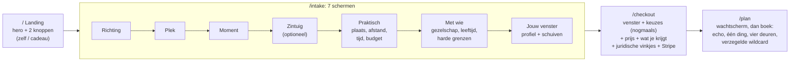
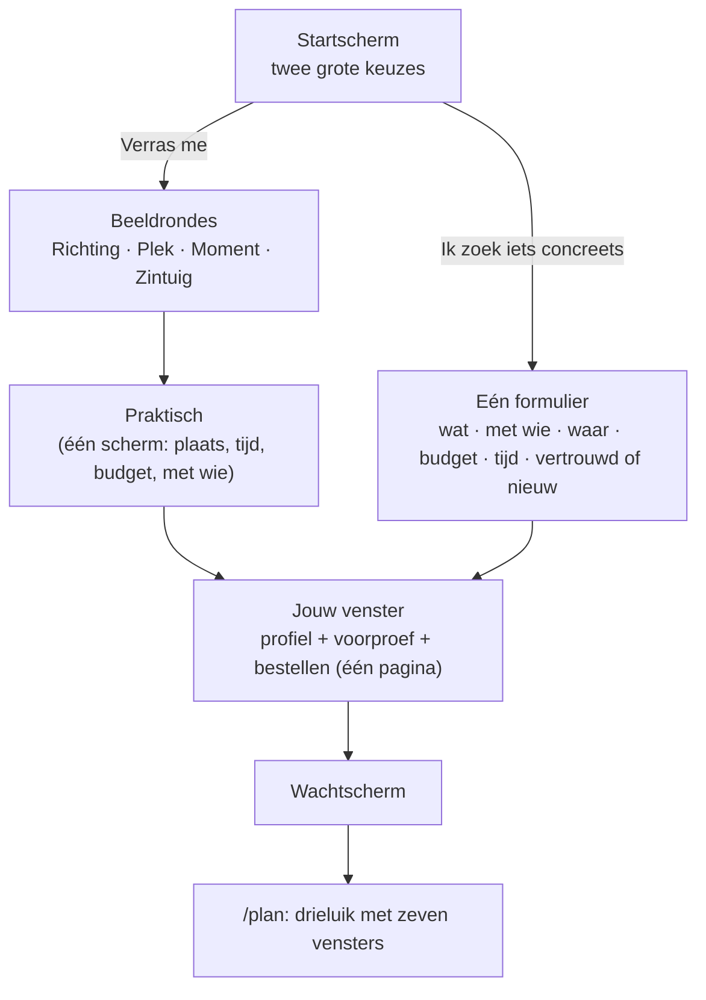

# Verbeterplan WindowInto

Opgesteld op 29 oktober 2026. **Alleen een plan: er is geen code, pagina, stijl, database, migratie, betaalinstelling of deployment gewijzigd**, en er zijn geen betaalde API-aanroepen gedaan (alles hieronder komt uit de codebase, de documenten in `docs/` en een alleen-lezen blik in de database).

**Leeswijzer.** Elke bewering heeft een label: **[Feit]** (in code of data gecontroleerd), **[Aanname]** (redelijk, niet bewezen), **[Advies]** (mijn voorstel) en **[Hypothese]** (te toetsen met een meting). Aan het eind staan de beslissingen die eerst nodig zijn.

---

## A. Managementsamenvatting

### De belangrijkste tekortkomingen

1. **De app heeft al een "drieluik" en "zeven vensters", maar noemt en toont ze niet zo.** [Feit] De motor kiest altijd zeven ideeën op een glijdende schaal (2 vertrouwd, 2 aangrenzend, 1 onverwacht, 1 uitdaging, 1 wildcard) en het resultaat toont ze al als vier "deuren" (Vertrouwd, Ontdekking, Onverwacht, Uitdaging) plus een verzegelde wildcard. Het nieuwe concept moet dit **aanscherpen en herbenoemen**, niet er een tweede structuur naast zetten.
2. **De route naar het eerste resultaat is lang en dubbel.** [Feit] Landing → 7 wizardschermen → aparte betaalpagina die het venster en de keuzes nóg eens toont → boek. Het profielscherm en de betaalpagina overlappen.
3. **De bibliotheek is breed maar dun waar jouw doelgroep zoekt.** [Feit] 455 activiteiten in 18 domeinen, alle op status `concept` (0 door een mens beoordeeld). Voor opera, ballet, ballroom, couture, kant, antiek/brocante, speeldozen, poppenhuizen, edelstenen/goudsmid en beautybehandelingen is er **niets of één algemeen item** (meting in sectie E).
4. **Er is nog geen enkel bewijs over gedrag of betalingsbereidheid.** [Feit] In de database staan 10 beeld-intakes, 0 echte betalingen en 2 feedbackregels. Elke uitspraak over conversie in dit plan is dus een hypothese.
5. **"Gratis" is een zichtbare zoekkeuze en trekt de verkeerde verwachting.** [Feit] De budgetkeuze heeft "Hou het gratis"; 4 van de 10 testintakes kozen die. Voor een product dat om concrete, betaalde ideeën draait is dat een tegenstrijdig signaal.

### De centrale strategie

Eén as, drie luiken, zeven vensters, twee routes, één betaalmoment:

- **Eén as** ("afstand tot jouw comfortzone", per persoon gemeten uit eigen keuzes), niet zeven losse categorieën.
- **Drieluik** = de drie zones van die as: *Dichtbij · Verder kijken · Onontdekt*.
- **Zeven vensters** = de zeven plekken op die as; elk idee in het boek is precies één venster. "Praktisch" is **geen** venster maar een eigenschap van elk idee (klaar om te doen), zie sectie C.2.
- **Twee routes** op één startscherm: *Verras me* (beeld-intake, bestaat) en *Ik zoek iets concreets* (één praktisch formulier).
- **Eén betaalmoment**, op de pagina waar je profiel staat, met een gratis voorproef die niets kost om te maken.

### De vijf belangrijkste verbeteringen

| # | Verbetering | Waarde |
|---|---|---|
| 1 | Zeven vensters + drieluik als productconcept, gevoed door de bestaande motor (`fit`, `reasons`) | begrijpelijk, uitlegbaar, onderscheidend |
| 2 | Route B "Ik zoek iets concreets": één scherm in plaats van zeven | snelle waarde voor wie niet wil associëren |
| 3 | Pagina `/checkout` samenvoegen met het profielscherm en "Met wie" met "Praktisch" | één pagina en één stap minder |
| 4 | ± 100 nieuwe activiteiten in twee nieuwe richtingen (Welzijn & verwennen; Mode, stijl & sieraden) plus ± 10 beeldfamilies | inhoudelijk rijker voor een vrouwelijke doelgroep zonder anderen uit te sluiten |
| 5 | Gratis voorproef (3 kaarten uit de motor, zonder API-kosten) en een prijstest; de keuze "gratis" vervalt | duidelijke betaalde meerwaarde |

### Kansen en risico's

- **Kans:** de motor, de bibliotheek, de foto's per activiteit, het onderzoek naar echte plekken en het profielportret bestaan al. Het meeste is **herordenen en aanvullen**, weinig nieuw bouwen.
- **Risico 1:** zonder gedragsdata kiezen we op structuur. Daarom staat meten (fase 0) vóór bouwen.
- **Risico 2:** de motorverbetering B4 (`fit`/`reasons`) zit achter dezelfde vlag als de schrijfverbeteringen B5, waarvan de blinde test 2-2 uitviel. Eerst splitsen, anders blokkeert een twijfelachtig onderdeel een goed onderdeel (sectie F.1).
- **Risico 3:** een gratis voorproef kan de betaling kannibaliseren. Mitigatie: alleen titel, foto en reden, geen plek, stappen of eerste actie; meten.
- **Risico 4:** meer activiteiten geven niet vanzelf betere aanbevelingen (sectie F.7).

---

## B. Analyse van de huidige situatie

### B.1 Wat er is [Feit, uit de code]

**Reis betalende gebruiker (vier pagina's):**



- Zijpagina's: `/shared/[id]` (deelbaar boek), `/delen`, `/privacy`, `/terms`, `/herroepingsrecht`, `/admin/*`.
- Drie wizardvarianten bestaan in code: `associations` (beeld-intake, nu 100%), `cards` en `legacy` (beide op 0%).
- Prijs: eenmalig €3,50 (testversie €6,00) via `NEXT_PUBLIC_WINDOW_PRICE_CENTS`, voor iedereen gelijk (build-variabele). Cadeau-optie bestaat. Geen accounts.
- Navigatie in de kop: "Hoe het werkt" en "Voorbeeld-Idea Book" plus de taalschakelaar.

**Motor en bibliotheek:**

- 455 activiteiten, 18 richtingen, 57 subgroepen, 42 tags, 50 curated combinaties (hybrids), 63 beeldfamilies (189 kaarten) in drie rondes. Per activiteit: tags (bruggen), sociale vormen, intensiteit, niveau, kosten, duur, binnen/buiten, seizoen (`months`), `supply` (253 common, 171 regional, 31 rare), veiligheidsklasse, een foto, en sinds de kennisfase optioneel `aliases`, `provenance`, `source_links`.
- Relaties komen **alleen uit gedeelde bruggen** (`graph.ts`: gewicht = ln(N/gebruik), stemmingstags tellen niet) plus curated combinaties. De motor kiest per bezoeker zeven zaden (2 vertrouwd, 2 aangrenzend, 1 onverwacht, 1 uitdaging, 1 wildcard) met harde filters (budget, inspanning, toezicht, sociale vorm, seizoen) en diversiteit (max. 2 per richting, MMR-achtige straf achter de vlag).
- Achter `KNOWLEDGE_ENGINE_V2`: `fit` (gemeten relevantie 0..1 tegen eigen keuzes), `reasons[]`, zichtbare keten, activiteit-specifieke invulling.
- Onderzoek naar echte plekken (web search, Haiku, gegroepeerd, cache per maand), nu met paginacontrole, beoordelingen en twee vervangrondes.

**Resultaatpagina `/plan`:** wachtscherm, echo ("Je koos…"), "Als je er maar één kiest", vier deuren met hartjes en "Dit ga ik doen", verzegelde wildcard. De eerdere afsluitband is vervallen.

### B.2 Wat goed werkt en moet blijven [Feit/Advies]

- Het venster als beeld (boogkozijn met vier ruiten die zich vullen), het profielportret "Zo kijken wij door jouw venster", de draad per deur ("Zo kwamen we hierop"), de echte plekken met controle, de harde regels E1–E6 (0 overtredingen in alle metingen), de testlimiet en de eerlijke wachtstand.
- De motor is deterministisch en gratis; alleen onderzoek en schrijven kosten geld (± $0,15–0,30 per boek, gemeten in Stap 56, 78 en 103). **Dit is de sleutel voor de gratis voorproef.**

### B.3 Wat niet aansluit op de doelstelling [Feit, tenzij anders gemeld]

| Punt | Bevinding |
|---|---|
| Overlap | `/checkout` herhaalt het venster en "Jouw keuzes" die het profielscherm net toonde |
| Zeven schermen | Alleen "Zintuig" is optioneel; "Praktisch" en "Met wie" zijn twee korte schermen met verwante velden |
| Benaming | De deuren heten Vertrouwd/Ontdekking/Onverwacht/Uitdaging; het concept "luik" en "venster 1-7" ontbreekt |
| "Praktisch" als reden | Nergens in de motor een aparte praktische route: wie iets concreets wil doorloopt toch zeven beeldschermen |
| Gratis | Budgetkeuze "Hou het gratis" ( `dictionaries.ts` ), engine-pad `strictFreeCost`, evaluatieprofielen met `free` |
| Bibliotheekkwaliteit | 0 van 455 op `reviewed`/`live`; de motor behandelt `concept` als bruikbaar |
| Dekking doelgroep | zie sectie E.1 |
| Beeldmaat | Kaartbeelden zijn 4:5 (rondes) en 4:3 (activiteiten); de resultaatkaarten zijn groot en tonen tekstblokken |
| Meetbaarheid | Events bestaan (`docs/analytics-events.md`), maar er zijn geen cijfers; "tijd tot eerste relevante activiteit" is niet als event gedefinieerd |

### B.4 Wat ik niet kon vaststellen [ontbrekend bewijs]

- **Gedragsdata:** geen drop-off per scherm, geen conversie, geen tijd per scherm van echte bezoekers. In de database staan alleen 10 beeld-intakes, 4 daarvan met budget "gratis", 9 met minstens één zintuigkaart, 0 cadeau, 0 echte betalingen.
- **De live site en de Vercel-configuratie:** niet bekeken; alles komt uit de code.
- **Of beoordelaars/gebruikers de huidige deuren begrijpen:** twee testfeedbackregels, geen leesbaar patroon.

Informatie die ik nodig heb om dit plan te toetsen: PostHog-funnel van de beeld-intake (scherm voor scherm) over minstens enkele tientallen echte bezoekers, en de top-3 vragen die mensen stellen op de betaalpagina.

---

## C. Nieuwe gebruikerservaring

### C.1 Het drieluik (kritisch bekeken)

Jouw drie namen zijn goed als principe. Eén aanpassing: **"Nieuwe werelden" botst met een bestaande regel.** [Feit] In de intake is het woord "wereld" bewust uit de zichtbare tekst gehaald (een test, `vensterCopy.test.ts`, bewaakt dat). Daarom:

| Luik | Naam | Functie | Vensters |
|---|---|---|---|
| I | **Dichtbij** | herkenbaar, direct te kiezen | 1 en 2 |
| II | **Verder kijken** | logische volgende stap bij wat je al leuk vindt | 3 en 4 |
| III | **Onontdekt** | verrassend maar onderbouwd | 5, 6 en 7 |

**Visueel en functioneel (geen decoratie):**

- Drie hoge boogramen naast elkaar (op de telefoon drie tabs/een veegrij met de naam boven de boog). Het bestaande boogkozijn (`WindowFrame`) wordt hergebruikt. Per luik een eigen tint uit de bestaande paneeltinten (`--color-pane-*`: zand, salie, hemelblauw, pruim), zodat de drie luiken ook zonder tekst te onderscheiden zijn.
- Elk luik bevat 2–3 compacte kaarten (de zeven vensters). Het luik is ook de **navigatie**: één tik wisselt van luik, de rest van de pagina blijft staan.
- Het luik is ook een **filter voor Route B**: "iets vertrouwds" of "iets nieuws proberen" betekent luik I of III openen.
- Onderscheidend voor WindowInto: nergens anders is "hoe ver van je comfortzone" een zichtbare, per persoon berekende as met een uitleg per kaart ("Omdat je kant koos → couture").

### C.2 De zeven vensters (kritisch bekeken)

**Het probleem met de voorgestelde ladder [Advies].** Hij vermengt twee verschillende dingen: *hoe nieuw* iets is (Vertrouwd → Onontdekt) en *hoe uitvoerbaar* (Praktisch). "Praktisch" is geen trede maar een eis aan **elk** idee (er is een echte plek, een eerste stap, een prijs). Ook overlappen *Inspirerend* en *Verwant*, en *Uitdagend* gaat over inspanning, niet over nieuwheid. Een ladder met zeven gelijke treden die niet op één as liggen is verwarrend en niet uit te leggen.

**Voorstel: één as, zeven treden, "praktisch" als eigenschap.** De motor levert deze zeven al (2 vertrouwd, 2 aangrenzend, 1 onverwacht, 1 uitdaging, 1 wildcard); alleen de naam en de volgorde worden helder.

| # | Venster | Betekenis voor deze persoon | Bestaand motor-slot | Luik |
|---|---|---|---|---|
| 1 | **Vertrouwd** | wat je zelf koos, beter uitgewerkt | vertrouwd (gekozen of `fit` ≈ 1) | I |
| 2 | **Net anders** | zelfde richting, andere vorm (workshop i.p.v. kijken) | vertrouwd, andere subgroep | I |
| 3 | **Verwant** | deelt twee bruggen met wat je koos | aangrenzend (≥ 2 gedeelde tags) | II |
| 4 | **Verder kijken** | één brug, nieuwe subgroep of richting | aangrenzend (1 sterke brug) | II |
| 5 | **Verrassend** | onverwachte combinatie of keten | onverwacht (curated combinatie of keten via een middenstap) | III |
| 6 | **Uitdagend** | bewust een stap verder: meer inspanning of durf | stretch | III |
| 7 | **Wildcard** | zeldzaam en uit een richting die je niet koos; verzegeld tot je opent | wildcard | III |

**Uitgangspunten uit jouw lijst, hoe ze gehaald worden:**

- *Niet iedereen doorloopt alle zeven:* het boek toont alle zeven, maar de eerste scherm-weergave is één luik (Dichtbij); wie tevreden is stopt daar. De andere luiken zijn één tik verder.
- *Terug naar vertrouwd:* luik I staat altijd links en blijft bereikbaar.
- *Hoger ≠ duurder of riskanter:* de as meet nieuwheid, niet kosten. Kosten en inspanning staan als chips op elke kaart en worden apart gefilterd (budget, inspanning, toezicht zijn harde grenzen).
- *Comfortzone is persoonlijk:* de afstand wordt uit **eigen keuzes** berekend (sectie F.5), dus opera is voor de een venster 1 en voor de ander venster 5.
- *Uitleg per suggestie:* de keten bestaat al (`reasons`, `chain`, de draad per deur).

**Per venster (doel / type / presentatie / logica / overgang / voorbeeld):**

| Venster | Doel | Type activiteit | Presentatie | Logica | Overgang | Voorbeeld (kant) |
|---|---|---|---|---|---|---|
| 1 Vertrouwd | herkenning | wat je koos | foto + titel + 1 regel | `fit` ≥ 0,8, liefst eigen keuze | "Wil je dezelfde richting anders?" | Borduren in een atelier |
| 2 Net anders | zelfde, nieuwe vorm | andere `format`/subgroep in dezelfde richting | idem | hoge `fit`, andere subgroep | "Iets verder kijken?" | Kantklossen leren |
| 3 Verwant | logische uitbreiding | ≥ 2 gedeelde bruggen | idem + "Omdat je X koos" | `bridge` ≥ 2 | "Kijk breder?" | Een jurk maken |
| 4 Verder kijken | nieuwe zone | 1 sterke brug, nieuwe subgroep | idem | middelste `fit` | "Verrassing?" | Modegeschiedenis-museum |
| 5 Verrassend | nieuwsgierig maken | combinatie of keten | idem + keten | curated hybride of keten via middenstap | "Durf je meer?" | Een historische balavond |
| 6 Uitdagend | bewust iets verder | meer inspanning/durf, nog haalbaar | idem + inspanning-chip | stretch: kost en inspanning boven je schuiven | "Verzegeld venster" | Zelf een kostuum ontwerpen en dragen |
| 7 Wildcard | ontdekking | zeldzame richting | verzegeld, openen met één tik | `rarity` hoog, nieuwe richting | einde van de route | Improvisatietheater |

**Presentatie: één visuele route, geen zeven pagina's.** [Advies] Eén pagina `/plan` met het drieluik bovenaan en de vensters als compacte kaarten; geen zeven schermen. Reden: eenvoud en korte reis zijn eisen, en het boek bestaat al als één scrollpagina.

### C.3 De twee routes



**Route A, "Ontdek en laat je verrassen".** Bestaat grotendeels (beeld-intake). Wijzigingen: "Praktisch" en "Met wie" samen, betaalpagina erin.

**Route B, "Vind iets concreets".** [Advies] Eén scherm met chips en één schuif, geen beeldrondes:

| Veld | Verplicht | Bron |
|---|---|---|
| Wat voor activiteit (kies 1-3 richtingen of een zoekterm) | ja, of "verras me" | bestaande richtingkaarten + kaartenwizard |
| Met wie | ja (één tik) | `company` |
| Waar | ja | `location` (bestaat) |
| Wanneer/hoeveel tijd | ja (één tik) | `timeAvailable` |
| Budget | nee, standaard "tot €100" | `budget` (zonder "gratis") |
| Vertrouwd of nieuw | nee, standaard "mix" | bepaalt het luik waarmee het boek opent |

Afleiden in plaats van vragen: leeftijd (optioneel, bij profiel), sociale vorm (uit "met wie"), inspanning (uit "vertrouwd of nieuw" plus de schuif), gender (wordt niet gevraagd en niet gebruikt).

**Startscherm:** twee grote keuzekaarten ("Verras me" en "Ik zoek iets concreets"), cadeau wordt een kleine schakelaar in het volgende scherm in plaats van een derde knop. Eén startscherm, geen extra pagina.

### C.4 Navigatie: één pagina en één stap minder

**Huidig:** 4 pagina's (`/`, `/intake`, `/checkout`, `/plan`) en 7 wizardschermen: 10 stappen van landing tot boek (landing, 7 schermen, betaalpagina, boek), waarvan de overgang "Klopt, open mijn venster" een eigen klik is.

**Voorstel [Advies]:**

| Wat | Besluit | Reden |
|---|---|---|
| Pagina minder | `/checkout` verdwijnt als aparte pagina; het profielscherm krijgt onderaan het betaalblok (prijs, drie regels "wat je krijgt", vinkjes, Stripe-knop) | dubbel venster, dubbele keuzes, een extra klik; het profielscherm is al het moment waarop iemand "klopt" zegt |
| Stap minder | "Praktisch" en "Met wie" worden één scherm "Jouw situatie" met drie verplichte velden (plaats, tijd, budget) + gezelschap, en een uitklapblok "Meer opgeven" (leeftijd, sociale vorm, harde grenzen) | beide schermen bevatten korte, verwante velden; voorkomt een scherm zonder eigen waarde |
| Behouden | "Zintuig" blijft: 9 van de 10 testintakes kozen minstens één zintuigkaart [Feit, n = 10] | de stap wordt gebruikt |

Nieuwe reis Route A: landing → 4 beeldschermen (richting, plek, moment, zintuig) → Jouw situatie → Jouw venster + betalen → boek = **8 stappen** (was 10). Route B: landing → 1 formulier → venster + betalen → boek = **4 stappen**.

**Gevolgen om vooraf te besluiten:**

- `CLAUDE.md` noemt de checkout als apart kernscherm (scherm 3). De juridische inhoud (disclaimer, herroepingsrecht-vinkje, bevestiging vóór betaling) blijft letterlijk; alleen de pagina verdwijnt. Stripe's `cancel_url` verwijst nu naar `/checkout?payment=cancelled`: die route blijft bestaan als doorverwijzing naar het profielscherm met melding.
- Juridisch: de lange teksten mogen achter "Lees meer" als de verplichte bevestiging zelf zichtbaar blijft. Dit moet je jurist/akkoord geven.
- Alternatief als je de apart-pagina wilt houden: de stap minder vinden door "Moment" en "Zintuig" samen te voegen; die verdient geen voorkeur omdat zintuigen gebruikt worden.

### C.5 Schermen en hoeveelheid informatie

| Scherm | Primaire handeling | Wat staat er | Maximale hoeveelheid |
|---|---|---|---|
| Start | kies route | twee kaarten met beeld en één zin | 2 keuzes, 1 regel elk |
| Beeldronde | tik 1–5 beelden | 9 kaarten, titel max. 3 woorden | 9 kaarten |
| Jouw situatie | "Verder" | 4 velden, 1 uitklapblok | 4 + optioneel |
| Route B-formulier | "Toon mijn ideeën" | 5 velden, 2 optioneel | 5 |
| Jouw venster | "Open mijn venster" | profielportret, venster, 3 voorproefkaarten, 3 regels "wat je krijgt", prijs, vinkjes | 1 CTA |
| Boek | open een luik | drieluik, 7 kaarten, "Als je er maar één kiest" | 7 kaarten |

---

## D. Visueel ontwerpconcept

**Stijl [Advies].** Blijf in het merk (Warm Walnut, goud, Newsreader voor koppen, Plus Jakarta Sans voor tekst, 8/12/18 px radius, geen schaduwen of gloed). "Vrolijker" komt uit drie dingen die al in de tokens zitten: de vijf paneeltinten per luik, één gouden accent op wat actief is, en meer kleurrijke foto's (de activiteitsfoto's hebben een accentkleur per richting). Geen roze- of bloemenstereotype: de aantrekkingskracht komt uit onderwerpen en beeld (textuur, licht, ambacht), niet uit kleur.

**Kaarten (resultaat en voorproef) [Advies]:**

- Beeldverhouding **4:3** overal (de activiteitsfoto's zijn al 4:3, 800 px). Op de telefoon 2 kolommen (± 165 × 124 px), op de computer 3–4 kolommen. [Aanname] Dat toont op een telefoon ongeveer 4 kaarten zonder scrollen (niet gemeten).
- Op de kaart: titel (max. 40 tekens), één regel waarom (max. 60 tekens), drie chips (kosten, duur, binnen/buiten), een hartje.
- Alles verder (stappen, plek, beoordeling, keten, eerste actie) pas in het bestaande venster (`IdeaDialog`) na een tik.

**Tekst:** titels 2–4 woorden waar het kan, geen alinea's in lijsten, uitleg alleen onder "Waarom dit bij jou" na een tik. De hoogste tekstlast in de huidige reis zit op de betaalpagina en het profielscherm; die worden drie regels plus een uitklap.

**Wireframe, startscherm:**

```
┌────────────────────────────────────────────┐
│  WindowInto                         NL | EN │
│                                             │
│   Ontdek wat er mogelijk is voor jou.       │
│                                             │
│  ┌────────────────┐  ┌────────────────┐     │
│  │ [foto boog]    │  │ [foto agenda]  │     │
│  │ Verras me      │  │ Ik zoek iets   │     │
│  │ kies beelden   │  │ concreets      │     │
│  │ ~2 min         │  │ ~30 sec        │     │
│  └────────────────┘  └────────────────┘     │
│        Nieuw · € 3,50 · geen account        │
└────────────────────────────────────────────┘
```

**Wireframe, "Jouw venster" (profiel + voorproef + bestellen):**

```
┌────────────────────────────────────────────┐
│ Zo kijken wij door jouw venster             │
│ Je zoekt gezelligheid zonder poespas.       │
│ [venster met 4 ruiten gevuld]               │
│                                             │
│ Een voorproef                               │
│ ┌──────┐ ┌──────┐ ┌──────┐                  │
│ │foto  │ │foto  │ │foto  │   Dichtbij · Verder│
│ │Borduur│ │Kantkl│ │Balavond│  kijken · Onontdekt│
│ └──────┘ └──────┘ └──────┘                  │
│ Zes ideeën meer, met echte plekken en een   │
│ eerste stap, zitten in je boek.             │
│                                             │
│ Wat je krijgt   ✓ 7 ideeën ✓ echte plekken  │
│                 ✓ eerste stap per idee      │
│ € 3,50   [ Open mijn venster ]              │
│ ☐ Ik begrijp dat het herroepingsrecht...    │
└────────────────────────────────────────────┘
```

**Wireframe, het boek:**

```
┌──── Dichtbij ────┬─ Verder kijken ─┬─ Onontdekt ──┐
│ [kaart 1][kaart 2]│[kaart 3][kaart 4]│[5][6][7 ▒]  │
└───────────────────┴──────────────────┴─────────────┘
Als je er maar één kiest:  [grote kaart] 
```

Hoe een statische visualisatie later gemaakt wordt: de bestaande componenten (`WindowFrame`, `IdeaDialog`) met voorbeeldkaarten uit het voorbeeld-Idea Book in een tijdelijke preview-route, daarna schermen op 390 en 1280 px bekijken. Dat is bouwwerk en valt buiten dit plan.

---

## E. Activiteitenbibliotheek en associatiemodel

### E.1 Dekking van de gevraagde onderwerpen (meting, 29 oktober)

Gemeten met zoektermen op id en NL/EN-naam in `src/lib/discovery/data/*.json`:

| Gebied | Aanwezig | Ontbreekt |
|---|---|---|
| Wellness | sauna, thermen, massage, floattank, yoga, pilates | spa-dag/wellnessweekend, beautybehandelingen, high tea, hammam/scrub |
| Mode, textiel | borduren-weven, naaien, breien-haken, quilten, kringloop/vintage | couture-atelier, kant(klossen), modeshow, persoonlijke stijl, patronen tekenen, vintagewinkels als eigen doel |
| Juwelen | "Sieraden maken" (zilver of kralen) | edelstenen, parels, goudsmid, juwelenwinkel, vintagejuwelen |
| Nostalgie, objecten | poppentheater, miniaturen, kringloop | speeldozen, poppenhuizen, antiek/brocante, curiosa |
| Dans en podium | dansen, swingdansen, paaldansen, concert, variété, improvisatie, amateurtoneel | **ballet, opera, ballroom/stijldansen**, musical, modeshow |
| Creatief, sociaal | pottenbakken, schilderen, bloemschikken, parfum, zeep, kaarsen, wijnproeverij, theeceremonie, kook-club | kookworkshop als aparte vorm, proeverijen (chocolade, kaas, gin), vriendinnen-formats |

**Conclusie [Feit]:** de bibliotheek heeft de brede onderwerpen, maar mist de specifieke, esthetische activiteiten waar de doelgroep op zoekt. 455 → ± 560 activiteiten dekt dit.

### E.2 Vier niveaus, expliciet scheiden [Advies]

| Niveau | Wat het is | Waar het hoort | Voorbeeld |
|---|---|---|---|
| Interesse (onderwerp) | zeer algemeen, niet te ondernemen | **tag** (brug) en beeldfamilie | `juwelen`, `couture` |
| Activiteit | iets wat je kunt doen | **activiteit** in de bibliotheek | "Zelf een zilveren ring maken" |
| Aanbieder/plaats | waar het kan | **onderzoek** (niet opgeslagen, per plaats en maand) | een goudsmidatelier in Utrecht |
| Associatie | verrassende verbinding | **relatie** (gedeelde brug, curated hybride, keten) | kant → couture → modegeschiedenismuseum |

Nu mengt de bibliotheek soms niveau 1 en 2 ("Sieraden maken" is een activiteit, maar het onderwerp "juwelen" bestaat niet als eigen brug). Voorstel: nieuwe bruggen toevoegen waar een onderwerp meerdere activiteiten verbindt (zie E.4), niet nieuwe activiteiten per onderwerp.

### E.3 Categorieën en voorbeelden [Advies]

**Twee nieuwe richtingen** (de balansregel van 15% per richting blijft ruim gehaald):

- **Welzijn & verwennen** (± 25): spa-dag, hammam en scrub, gezichtsbehandeling, manicure-avond, kruidenbad maken, aromatherapie, forest bathing, wellnessweekend, high tea, stijladvies, make-up workshop, zonsopgang-yoga, geurkaarsen-avond. Zonder medische of therapeutische claims (bestaande disclaimer).
- **Mode, stijl & sieraden** (± 30): couture-atelier bezoeken, patroon tekenen, een jurk maken in een naaicafé, kantklossen, hoeden maken, zijde schilderen, indigo/batik verven, kledingruil, modeshow bezoeken, modegeschiedenismuseum, vintagemarkt, edelstenen slijpen, kralen rijgen, goudsmeden voor beginners, parels rijgen, vintagejuwelen zoeken.

**Aanvullingen in bestaande richtingen** (± 45):

- Podium: ballet-les voor volwassenen, ballet kijken, opera-avond of operaworkshop, ballroom en stijldansen, tango, historische balavond (bestaat als "Historische dans"), musical, modeshow.
- Verzamelen/nostalgie: speeldozen, poppenhuizen en miniaturen bouwen, antiek en brocante, curiosa-winkels, ansichtkaarten, serviezen.
- Creatief en eten: kookworkshop (patisserie, macarons, sushi), proeverijen (chocolade, kaas, thee, gin), aquarel, kalligrafie (bestaat).
- Sociaal: vriendinnen-formats als **sociale vorm** blijft `small_group`/`with_known`; geen nieuw geslachtsgebonden veld.

**Beeldfamilies** (± 10 nieuwe, elk met drie varianten, in de bestaande ronden "plek", "moment" en "zintuig"): linnen en kant, parelglans, balzaalkroonluchter, spa-damp, passementerie en knopen, poppenhuis in miniatuur, zijde in beweging, theehuis met servies, vintage etalage, kristal en glas. Zo kiest iemand die dit mooi vindt ook echt op beeld, zonder dat ergens "vrouw" wordt gevraagd.

**Nieuwe bruggen (tags)** [Advies]: `style` (mode en stijl), `wellbeing` (verwennen), `dance` (los van `movement`), `adornment` (sieraden en versiering), `nostalgia` (naast `retro`, voor romantische objecten). Elk moet bruggen vormen met minstens twee bestaande tags (validator eist dat).

**Aanvullende regel:** geen geslachtsfilter. Personalisatie loopt uitsluitend via gekozen beelden, tags en gezelschap.

### E.4 Dekking en kwaliteit beoordelen [Advies]

1. **Persona-sonde** in het bestaande evaluatieharnas (`scripts/eval`): 30 vaste, benoemde profielen per onderwerp ("liefhebber van couture en kant", "operaliefhebber, partner, €100", …). Elke sonde moet ≥ 3 activiteiten uit het onderwerp in de top-7 krijgen én minstens één per luik. Gratis, deterministisch, in `npm test`.
2. **Verweesde activiteiten:** een activiteit zonder één verbinding ≥ `BRIDGE_MIN` is onbereikbaar; de validator meldt dat nu niet.
3. **Reviewstatus:** nu `concept` voor alles. Voorstel: eerst alle nieuwe en de 100 meest getoonde activiteiten laten beoordelen (`reviewed_by` bestaat al), dan `minStatus: "reviewed"` laten gelden voor wat getoond wordt zodra genoeg beoordeeld is.
4. **Dekking per as:** `taxonomy:report` krijgt een tabel richting × luik (hoeveel activiteiten kunnen op elke trede voorkomen).
5. **Kostenschatting nieuwe inhoud [Aanname]:** ± 100 activiteiten + 30 beeldkaarten ≈ 17 Gemini-vellen 3x3 ≈ **$2,3**; schrijven en filteren is eigen werk (€0, zoals Stap 88 en 105); reviewtijd voor jou: ± 3–4 uur voor 100 items als steekproef.

---

## F. Aanbevelingsengine

### F.1 Wat er al is en wat de architectuur aankan [Feit]

De motor kan dit plan **grotendeels dragen**:

- Deterministisch en gratis, met harde filters, diversiteit en `fit`/`reasons`.
- De zeven slots komen al uit één selectie. Het enige wat ontbreekt is de **expliciete as** en een **comfortzone-schatting**.

**Eerst nodig (fase 0):** de vlag `KNOWLEDGE_ENGINE_V2` bundelt twee dingen die anders te beoordelen zijn: **B4** (ranking en `fit`; gemeten voordeel: minder varianten van hetzelfde, geen onbekende kosten bij gratis) en **B5** (schrijven: invulregels, eerlijke herkomst; blinde test 2 voor, 2 tegen). Zolang ze één vlag delen, zou het zichtbaar maken van de as ook B5 aanzetten. Voorstel: splitsen in `KNOWLEDGE_RANKING_V2` en `KNOWLEDGE_WRITING_V2`.

### F.2 Datamodel

| Entiteit | Bestaat | Uitbreiding |
|---|---|---|
| Interesse | als tag + beeldfamilie | nieuwe bruggen (E.3) |
| Activiteit | ja (455) | 2 richtingen, 100+ nieuwe; optioneel `home` (thuis/online) facet, zie besluit D8 |
| Aanbieder | niet opgeslagen (onderzoek per plaats+maand, cache `local_research_cache`) | cache blijft; ratings zitten al in het onderzoek |
| Associatie | gedeelde tags, `hybrids.json`, `chain` | `hybrids` ± 30 extra (kant × couture, sieraden × antiek, opera × diner) |
| Venster | niet expliciet | afgeleid per idee: `window: 1..7` uit `fit` + slot (niet opgeslagen als bron, wel in `ideas_json` voor weergave) |

Geen nieuwe database. Wel één kolom voor het venster per idee in `ideas_json` (JSON, geen migratie nodig).

### F.3 Relaties tussen activiteiten en vensters

Jouw zeven relatietypen vertalen naar bestaande en nieuwe signalen:

| Relatie | Bron nu | Gebruik |
|---|---|---|
| Semantisch / interesse | gedeelde non-generic tags (`bridge`) | vensters 2–4 |
| Sfeer | stemmingstags (tellen niet als brug) | alleen voor tie-breaks en foto's |
| Doel | tags `learning`, `caring`, `play`, `competition`, … | filter bij Route B ("ontspannen", "leren", "samen") |
| Context | harde filters (budget, tijd, seizoen, sociale vorm, toezicht) | altijd, vóór de ranking |
| Ontdekking | `unexpected`-keten, curated hybrids, `rarity` | vensters 5–7 |
| Praktisch | `supply`, geverifieerde aanbieder, `replace`-rondes | **eis** voor elk idee, geen venster |

### F.4 Rangschikken

Per kandidaat, in deze volgorde (alle gewichten in `engine/weights.ts`, zoals nu):

1. Harde grenzen (nooit overschreven door een score).
2. `fit` (afstand tot eigen keuzes, 0..1) bepaalt het **venster**: banden uit de verdeling per bezoeker, niet vaste drempels.
3. Per venster een gewogen mix van `fit`, haalbaarheid (aanbieder gevonden), nieuwheid en diversiteit (MMR).
4. Voor Route B: gewicht op haalbaarheid en beoordeling omhoog; luiken I en II eerst.
5. De uitleg per kaart uit `reasons`.

**Beoordelingen** (nu alleen uit zoekresultaten) tellen mee in de keuze van de plek binnen een idee, niet in de keuze van de activiteit.

### F.5 Comfortzone zonder extra vragen [Advies]

Alleen uit signalen die iemand al geeft (past binnen het scope-besluit "geen complexe afgeleide profielopbouw", zie sectie J):

- **Vertrouwd-set** = de gekozen beelden (tagprofiel) en gekozen richtingen.
- **Afstand** = gelijkenis (`sim`) van een activiteit met die set.
- **Durf** = de schuiven `practicalToWild` en `surprise`, de leeftijd (alleen als zachte weging, nooit uitsluiten) en de gekozen inspanning.
- **Per persoon, niet per onderwerp:** opera is venster 1 voor wie operabeelden koos en venster 5 voor wie dat niet deed.
- Geen profiel over meerdere sessies tenzij iemand het apparaatgeheugen aanzet (bestaand, opt-in).

### F.6 Herhaling en irrelevantie voorkomen

- Bestaand: max. 2 per richting, MMR-straf op gedeelde bruggen, historie over de laatste twee boeken (opt-in), `exclude`, seizoen, aanbodcontrole.
- Nieuw: een idee mag niet in twee vensters van hetzelfde boek op dezelfde subgroep staan; een associatie (keten) wordt alleen getoond als elke schakel een gedeelde non-generic brug heeft (nu al de eis voor `chain`, wordt een test).
- Bekende zwakte [Feit]: naamvergelijking vindt dubbelen onder andere woorden niet (zeven gevallen in Stap 105). Voor nieuwe inhoud: eerst `grep` op bestaande labels, en een kandidatenlijst in de importer.

### F.7 Feedback verwerken [Advies]

- Bestaand: hartje (feedback), "Dit ga ik doen" (`committed_idea_key`), testvragenlijst (`door_pick`, `door_kind`).
- **Alleen geaggregeerd of pseudoniem**, zoals nu: per activiteit het aandeel hartjes per venster; wekelijks een rapport in de admin; **gewichten handmatig bijstellen** (geen automatisch leren in de eerste versie).
- Een eenmalige reactie is geen blijvende voorkeur (Stage-B-regel).

### F.8 Een grote bibliotheek kwalitatief goed houden

- Meer activiteiten ≠ betere aanbevelingen: bepalend zijn bruggen, aanbod en uitleg. Daarom groeit de bibliotheek per **gat** (E.1), niet per aantal.
- Proces: divergeren → convergeren → review → `reviewed`; dubbelcheck op bestaande labels; foto's pas na akkoord; `supply` en `months` altijd invullen.
- Bronnen: Wikidata (S3) is verwerkt; verder alleen met schone licentie (zie `docs/knowledge-sources.md`).

---

## G. Verdienmodel

**Vastgesteld [Feit]:** eenmalig €3,50 (test €6,00); kosten per boek ± $0,15–0,30 (≈ €0,14–0,28); Stripe-kosten zijn volgens mijn aanname ± €0,25 + 1,5% (controleer jouw tarief), dus netto ± €2,8–3,0 per boek op €3,50.

**Producteisen:** (1) de keuze "gratis" vervalt, (2) waarde helder vóór betalen, (3) aantrekkelijk voor wie concreet wil, (4) simpel en zonder lappen tekst.

**Dit is niet hetzelfde:** "gratis" als **zoekkeuze** (budgetknop) vervalt; een **gratis voorproef** is een marketingmiddel. Dat zijn twee besluiten (D5, D6).

### G.1 Varianten

| | **V1. Eenmalig boek (nu)** | **V2. Voorproef + ontgrendelen (advies)** | **V3. Tegoed of seizoenspas** |
|---|---|---|---|
| Wat | profiel gratis, dan €X voor 7 ideeën | profiel gratis + 3 kaarten (één per luik, titel/foto/reden, geen plek of stappen), dan €X | 3 vensters voor €Y, of een nieuw venster per seizoen |
| Begrijpelijk | zeer (één prijs) | zeer; je ziet wat je krijgt | minder (tegoedcode, geldigheid) |
| Conversie [Hypothese] | basis | hoger dan V1 omdat waarde zichtbaar is; risico: nieuwsgierigheid is bevredigd | onbekend; laagdrempeliger per boek, drempel hoger per bestelling |
| Ontwikkelkosten | geen | klein (engine bestaat, kaarten bestaan, geen API-aanroep) | middel (code, e-mailtegoed, verval) en: geen accounts |
| API-kosten niet-betalers | €0 (alleen profiel) | €0 (engine is gratis; **geen** onderzoek of schrijven) | €0 |
| Terugkerende waarde | laag (eenmalig) | laag | hoger: seizoen verandert, de motor houdt al rekening met maand en historie |

### G.2 Advies

**V2 als basis, V3 later als er herhaalgedrag blijkt.** Reden: de gevraagde "waarde voor betalen duidelijk maken" wordt het goedkoopst opgelost door iemand drie echte voorbeelden uit zijn eigen selectie te laten zien, zonder dat dit API-geld kost. De voorproef is **alleen** wat de motor al weet (activiteit, foto, waarom); concrete plek, stappen en eerste actie zijn de betaalde laag.

**Risico's V2:** de definitieve selectie kan afwijken van de voorproef (ideeën zonder aanbieder worden vervangen). Mitigatie: de voorproef toont **alleen activiteiten die geen aanbieder nodig hebben of waarvoor het onderzoek in de cache al iets vond**, en zegt "kan nog veranderen". Meten: afwijking en klachten.

**Prijs:** testen in periodes, niet per bezoeker. De prijs is nu één build-variabele voor alle bezoekers; een echte A/B-test per bezoeker vraagt een kleine server-aanpassing (zie fase 4). Voorstel: €3,50 vs €4,95 vs €6,00 in drie blokken van 2 weken, vergelijk conversie en `would_pay`.

**Uitleg zonder lappen tekst:** drie regels "Wat je krijgt" (zeven ideeën met echte plekken, een eerste stap per idee, een verzegelde wildcard) en één prijsregel; juridische tekst achter "Lees meer", de bevestiging blijft zichtbaar.

---

## H. Prioriteiten en implementatieplan

| Fase | Inhoud | Afhankelijkheden | Complexiteit | Gebruikerswaarde | Belangrijkste risico's |
|---|---|---|---|---|---|
| **0. Voorbereiding** (1–3 dagen) | beslissingen D1–D10; vlag splitsen; nulmeting inrichten; scope-bevestiging | jouw besluiten | S | geen directe | zonder besluiten bouwt niets zinnigs |
| **1. UX en navigatie** (1–2 weken) | start met twee routes; `/checkout` in profielscherm; "Praktisch"+"Met wie" samen; "gratis" uit de budgetkeuze (nieuwe schaal: tot €25 · tot €100 · maakt niet uit); kaarten 4:3 en compacter; luikennamen | fase 0; juridische ok | M | hoog: kortere reis, helderder | betaalflow raken (Stripe-terugkeer), tests aanpassen (Playwright + intake) |
| **2. Bibliotheek** (2–3 weken, deels parallel) | 2 nieuwe richtingen, ± 100 activiteiten, ± 10 beeldfamilies, nieuwe bruggen, hybrids, persona-sonde, reviewstatus | fase 0 | M (veel inhoud, weinig code) | hoog voor de doelgroep | kwaliteit en dubbelen; reviewlast voor jou |
| **3. Engine en vensters** (2 weken) | `fit` standaard (na splitsing), venster per idee, luikweergave, Route B-motorpad, uitleg per kaart, feedback-rapport | fase 0 en 2 | M–L | hoog: uitlegbaar en persoonlijk | selectie verschuift (basisregressie in tests); One Thing-gevoeligheid (zie Stap 101) |
| **4. Commercieel** (2–4 weken meten) | voorproef (V2), prijsperiodes, metingen, optioneel V3 | fase 1 en 3 | S–M | middel tot hoog | kannibalisatie; te weinig verkeer voor conclusies |

**Acceptatiecriteria per fase** (zonder verzonnen percentages):

- **Fase 1:** een bezoeker bereikt het boek via één pagina minder en één scherm minder dan nu (10 → 8 stappen Route A, 4 Route B); de juridische bevestiging staat zichtbaar vóór de betaalknop; geen horizontale scroll op 375–412 px; alle Playwright- en unit-tests groen; de keuze "gratis" komt nergens meer in de intake voor (gratis activiteiten blijven wel mogelijk).
- **Fase 2:** persona-sonde slaagt voor alle onderwerpen uit sectie E.1; `taxonomy:check` 0 fouten; elke nieuwe activiteit heeft foto, `supply`, `months`, tier-2-notitie waar nodig; Jans steekproefreview afgerond.
- **Fase 3:** E1–E6 blijven 0 overtredingen over 3 × 500 profielen; elk boek heeft zeven vensters met uitleg; aantal vensters per luik is 2-2-3; blinde vergelijking op minstens 4 profielparen met uitgevoerde rubricvragen is niet slechter dan de huidige motor.
- **Fase 4:** een prijsblok loopt minstens twee weken; de voorproef kost €0 aan API; de afwijking tussen voorproef en boek wordt gemeten.

---

## I. Meetplan

**Nulmeting eerst.** [Advies] Zet het bestaande funnel-dashboard in PostHog op (events bestaan al), laat een groep testers (de 50 bekenden uit `docs/testen-met-bekenden.md`) door de huidige flow gaan, en leg deze vier getallen vast voordat er iets verandert: tijd van `intake_started` tot `plan_viewed`, uitval per scherm, aandeel dat de betaalpagina bereikt, aandeel dat betaalt. Zonder een steekproef van enkele tientallen is elk verschil ruis; bij lage aantallen kwalitatief rapporteren.

**Indicatoren en events:**

| Indicator | Hoe | Event (nieuw gemarkeerd) |
|---|---|---|
| Tijd tot eerste relevante activiteit | `intake_started` → `plan_viewed`; voor Route B → **`route_chosen`**, **`results_viewed`** | `route_chosen {route}` |
| Uitval per scherm | bestaande `intake_page_*` | – |
| Gebruik van Route B | `route_chosen` | nieuw |
| Bekeken suggestie | `idea_opened` (bestaat) | – |
| Bewaard/passend | hartje (`idea_liked`), "Dit ga ik doen" (`one_thing_committed`) | – |
| Luikgebruik | **`window_opened {luik}`** | nieuw |
| Voorproef bekeken | **`teaser_viewed`** | nieuw |
| Conversie | `checkout_pay_clicked` → betaald | (na samenvoegen: **`pay_clicked`**) |
| Betaalbudget (zonder "gratis") | **`budget_chosen {bucket}`** (id, geen tekst) | nieuw |
| Tevredenheid | `test_feedback_submitted` (bestaat) | – |

**Hypothesen en experimenten:**

| # | Hypothese | Experiment |
|---|---|---|
| H1 | Route B verkort de tijd tot een relevante suggestie | vergelijk mediane tijd Route A en B (zelfde bezoekers niet mogelijk; segmenteer) |
| H2 | Eén pagina minder verhoogt het aandeel dat bestelt | voor/na, plus de nulmeting |
| H3 | De voorproef verhoogt de conversie | twee periodes of een eerlijke 50/50-splitsing |
| H4 | "Gratis" weglaten verandert de keuze voor budgetten niet negatief | verdeling van `budget_chosen` vóór en na |
| H5 | De vensters (uitleg) verhogen vertrouwen in relevantie | `doors_score` uit de testvragenlijst |
| H6 | Nieuwe richtingen vergroten het aandeel dat iets "echt gaat doen" | `door_pick` per richting |

---

## J. Kritische eindbeoordeling

**Tegenspraken in de opdracht en hoe ik ze oplos:**

1. *Zeven vensters als ladder vs. "Praktisch" als venster.* Een rij kan niet tegelijk nieuwheid en uitvoerbaarheid zijn. Opgelost met één as; praktisch is een eis aan elk idee.
2. *"Weinig tekst en keuzes" vs. "veel meer activiteiten".* Meer bibliotheek mag niet meer schermen of keuzes betekenen; alles blijft achter de motor.
3. *"Gratis moet vervallen" vs. een gratis voorproef.* Beide kunnen als je ze scheidt: zoekkeuze weg, voorproef als marketingmiddel (besluit nodig).
4. *"Comfortzone persoonlijk inschatten" vs. scope "geen complexe afgeleide profielopbouw" in `CLAUDE.md`.* Mijn voorstel blijft bij expliciete keuzes en opt-in geheugen; zo niet, dan moet die regel worden bijgesteld.
5. *"Eén pagina minder" vs. de kernschermenlijst in `CLAUDE.md`.* Checkout verdwijnt als pagina, niet als functie; de lijst moet worden aangepast.

**Mijn plan beoordeeld:**

- **Onnodige complexiteit:** het drieluik en de vensters zijn presentatie boven een bestaande selectie; het risico is dat ze als extra laag voelen. Houd ze strak: drie namen, geen extra scherm.
- **Onlogische navigatie:** Route B slaat de beeldrondes over; zorg dat de opgeslagen intake dezelfde velden vult zodat alle motorfuncties werken.
- **Te veel keuzes/tekst:** de startpagina heeft twee knoppen; het uitklapblok "Meer opgeven" houdt het scherm kort.
- **Commerciële meerwaarde:** blijft een hypothese tot er betalende of bereidwillige testers zijn (0 echte betalingen).
- **Onvoldoende relevante activiteiten:** ± 100 nieuwe items zijn een eerste stap; de persona-sonde meet of dat genoeg is.
- **Onlogische associaties:** de motor kent geen semantiek, alleen tags; nieuwe bruggen moeten met de hand verantwoord worden en de ketenregel (elke schakel een echte brug) wordt een test.
- **Technische complexiteit:** de enige architectuurwijziging die ik voorstel is het splitsen van een vlag en een JSON-veld; geen nieuwe database, geen nieuwe stack.
- **Risico's voor bestaande functionaliteit:** Stripe-terugkeer (`cancel_url`), wijzig-links vanaf de betaalpagina, de testlimiet, en de intake-Playwrighttests raken de samengevoegde pagina.
- **Het drie-wizardprobleem:** `cards` en `legacy` staan op 0% maar zitten in de code. Opruimen kan na fase 1 (apart besluit).

**Aannames die nog gevalideerd moeten worden:** dat de doelgroep op beeld wil kiezen in plaats van op woorden; dat een voorproef niet kannibaliseert; dat €3,50 de juiste prijs is; dat de markt Nederland is (zie D7: een Madrid-boek bleek mogelijk, maar de plaatskeuze en het onderzoek zijn voor Nederland gebouwd); dat 4 van 10 "gratis"-kiezers geen blijvend betalende groep zijn (n = 10).

---

## K. Beslissingen die eerst nodig zijn

| # | Beslissing | Mijn advies |
|---|---|---|
| D1 | Eén as met zeven treden en "Praktisch" als eigenschap, niet als venster? | ja |
| D2 | Namen luiken: Dichtbij · Verder kijken · **Onontdekt** (i.p.v. "Nieuwe werelden", wegens het woord "wereld") en venster 7 heet "Wildcard" | ja |
| D3 | `/checkout` samenvoegen met het profielscherm, en "Praktisch" + "Met wie" samen (10 → 8 stappen)? Aanpassing van `CLAUDE.md` en akkoord van de jurist op de samengevoegde pagina | ja |
| D4 | Route B bouwen als apart formulier (niet als de bestaande kaartenwizard)? | ja |
| D5 | De keuze "gratis" uit het budget; nieuwe schaal "tot €25 · tot €100 · maakt niet uit" | ja |
| D6 | Gratis voorproef (3 kaarten, geen API-kosten) als verdienmodel V2, prijsperiodes testen | ja |
| D7 | Markt: Nederland, of expliciet ook daarbuiten (dan onderzoek, plaatskeuze en taal aanpassen)? | eerst Nederland |
| D8 | Een "thuis/online"-facet toevoegen (open besluit K7 uit de kennisfase)? | ja, klein |
| D9 | `KNOWLEDGE_ENGINE_V2` splitsen in ranking en writing; ranking standaard aan na een blinde ronde met uitgevoerde rubriek | ja |
| D10 | Twee nieuwe richtingen en ± 100 activiteiten + ± 10 beeldfamilies (≈ $2,3 aan beelden), met jouw steekproefreview | ja |
| D11 | Scope: de regel "geen complexe afgeleide profielopbouw" bevestigen met de beperking tot expliciete keuzes en opt-in geheugen | ja |

---

*Kosten van dit plan: €0 aan betaalde API-aanroepen; alleen lokale analyse en één alleen-lezen databasevraag.*
